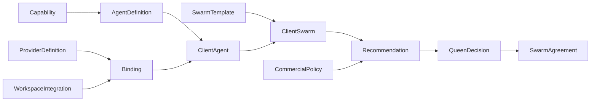
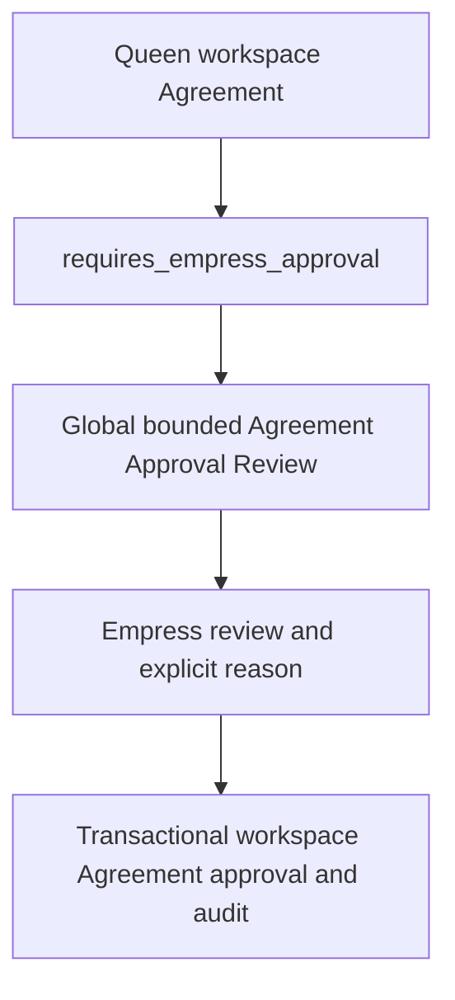

# HVM Empress operating-layer foundation

**PASS — FINAL POST-v9 VERIFICATION.** Dev schema v9 is installed and verified. All nine installed validators and 29 new indexes match the reviewed definitions; installed parity and data-integrity checks pass. See [the verification history and final results](investigations/empress-operating-layer-verification.md). No agent execution, frontend, payment collection or deployment is included.

## Reuse decisions

| Proposed concept | Existing foundation | Decision and reason |
| --- | --- | --- |
| Agent Definition | capabilities | New versioned `agent_definitions`, referencing existing capability IDs. A specialist agent can provide multiple capabilities; Capability remains a reusable function, not an agent identity. |
| Client Agent Instance | capability_instances | New `client_agents` with optional existing capability-instance references. Existing instances describe workspace/product capability enablement/output, lack agent version/slots and may represent non-agent functions. Do not rename or retrofit their meaning. |
| Swarm Template | commercial_packages | New versioned `swarm_templates`: provider-neutral job guidance, not a sellable package. |
| Client Swarm | commercial_packages | New `client_swarms`: actual workspace configuration and agent-instance composition. Packages remain commercial grouping of capabilities. |
| Commercial Policy | none | New versioned `commercial_policies`: governed economic assumptions and Queen authority, no hard-coded business rates. |
| Pricing Recommendation | commercial_charges | New immutable `pricing_recommendations`: economic estimate and frozen configuration/policy inputs, not a charge. |
| Commercial Agreement | subscriptions, packages, charges, entitlements | New `swarm_agreements`: canonical configured-Swarm terms. Existing subscription requires Product/provider; charges require capability/package targets. Reusing either would manufacture SKUs or billing records. Future execution can link existing records, without creating them now. |
| Integration Provider | hard-coded HVM provider list | New `integration_providers` global registry. Existing `workspace_integrations.provider` is the stable provider key; connections/secrets remain exclusively in that existing store. |
| Integration Binding | workspace_integrations | Embedded in client agent configuration, referencing connection ID and provider definition/version; no duplicate credential store. |
| Methodology Availability | code-owned methodology catalogue | New `methodology_availability` governing exact catalogue ID/version and compatible agent definitions; content stays in code. |
| Commercial treatment | billingTreatmentSchema | Reuse standard/bundled/waived/internal/promotional unchanged. |
| Authority | trusted Cognito + Partner assignments | Empress is an explicit server-configured human allowlist for platform operations. Queen uses active Partner membership plus active assignment, not client admin membership. No automatic Empress-to-all-client grant. |

The nine new collections are justified by distinct identity/history/authority boundaries, rather than treating capabilities, packages, subscriptions or portfolio Products as agents/Swarms. Existing commercial records remain canonical for their present functions. No global agent/provider/template seed is required. Lead Generation is a Swarm job, and Contact Management is the specialist capability; no Lead Gen/CRM Agent is registered.


## Central resource scope (authorization repair)

`RESOURCE_SCOPES` in `src/authorization/policy.ts` classifies every policy resource. Scope validation precedes both human grants and existing workload grants.

| Scope | Operating resources |
| --- | --- |
| Global, no workspace ID permitted | agent_definitions, integration_providers, swarm_templates, commercial_policies, methodology_availability |
| Workspace, valid workspace ID required | client_agents, client_swarms, pricing_recommendations, swarm_agreements |

Integration bindings are embedded client-agent configuration, and Queen decisions are embedded in Swarm Agreements; neither introduces a separate authorization resource. They inherit the containing workspace boundary.

An Empress-only human cannot access a client workspace through omitted scope or platform privilege. A Queen cannot access a global resource by adding workspace scope. A combined-role human uses each independent authority in the corresponding valid scope. Partner-derived admin/onboarder authority remains distinct from client admin/viewer membership. No person is special-cased.

Pre-existing policy resources retain the explicit `legacy_internal_or_workspace` classification: this preserves the existing Vapp internal versus HVM workspace grant rules rather than redesigning them. It does not assert that every persisted entity supports both scopes: existing services still enforce their stricter entity contracts. Brand/Brand Kit, connections, team membership, Hive definitions, Offers and legacy commercial/capability policy branches were not widened by this repair.

The central API returns booleans and sanitized `AuthorizationDenied` errors; it has no existing structured denial-reason contract. Invalid scopes fail before actor evaluation without introducing membership disclosures. Operating services retain independent resource-scope and relationship validation.

## Registry, instances and configuration

Definitions carry a stable key and explicit positive version. `(key, version)` is unique; IDs identify individual versions. Global records progress from draft to active to retired. Availability is internal, queens or experimental. Published definition content is immutable: create a new version rather than rewriting a published definition. `referenceVersion` is transactional reference-lock metadata, not a semantic definition revision.

Agent Definitions declare provided/required capability IDs, required/recommended agent versions, bounded configuration fields, provider-neutral integration slots, cost drivers and declarative Hive read/propose resources. Approval is human-only and scope is workspace. These declarations grant no execution permission and store no executable code. Capability remains a function; the Agent is the specialist definition that may provide it. No catalogue entries are seeded.

Provider Definitions describe operational capabilities, authentication metadata, customer-owned-account support and costs. They do not contain credentials. Client Agent bindings reference an existing `workspace_integrations` connection and an exact provider definition/version, along with slot, expected usage and cost treatment: client_funded, hvm_funded, pass_through or included_allowance. Alternative providers and multiple bindings are supported; failover execution is not implemented. The connection's existing provider key must match the selected definition. Existing connection adapters are not expanded by metadata registration.

Swarm Templates express jobs with required/recommended/optional agents, integration capabilities, configuration guidance and commercial assumptions. Client Swarms may use an exact template version or be custom. They reference independently configured Client Agents. Lead Generation is a Swarm/job; Contact Management is a future specialist capability. No Lead Gen Agent or CRM Agent exists in the registry.

Client Agents and Swarms have draft/configured/retired state and explicit configuration revision numbers. An edit increments revision and returns the record to draft. Configured is not running or activated. Readiness is calculated from configuration, required agent/dependency versions, required capabilities, integration slots and same-workspace connected/compatible providers. It is not persisted as a runtime-health flag. Retired definitions cannot be selected for new configuration/recommendations. Retirement never rewrites existing client configurations or historical commercial snapshots.



## Commercial authority and history

Commercial Policies are versioned global definitions with currency, margin assumptions, annual discount metadata, Queen discount/custom-price limits, permitted treatments, onboarding/usage/overage guidance and effectivity dates. A partial unique index allows one active policy per currency. Publishing/retiring policies is explicit; there is no automatic scheduled policy switch. Recommendation creation requires an active policy effective at that time.

A Pricing Recommendation is an immutable calculation artifact: it stores the selected policy/version, policy snapshot, Swarm ID/configuration revision and complete bounded configuration snapshots (including agent/provider data), economic inputs, separately supplied monthly/annual recommendations, onboarding recommendation, rationale and uncertainty. The current foundation accepts explicit recommendation inputs; it does not calculate or infer a market price with AI. Policy updates, new definition versions and template changes cannot dynamically rewrite this artifact.

A Queen decision retains the recommendation and chooses accept, percentage discount, fixed discount or custom recurring price, with treatment, reason, onboarding amount, commitment, billing frequency, effective dates and usage assumptions. The service computes final recurring/monthly-equivalent values and evaluates the pinned policy. Recommendations and final prices remain distinct. Policy exceptions require explicit Empress approval through an independently authorized workspace path. Proposed/approved/superseded/retired agreement states preserve the decision actor/time and any Empress approval actor/time/reason. Approved agreement intervals cannot overlap for the same workspace/Swarm.

Amounts are integer minor units. Monthly commitment is one month; annual commitment is twelve months. Annual commitment may be billed monthly or annually. The annual recommendation is an explicit input, not assumed to equal twelve monthly prices. A recommendation of £1,000/month and £10,800/year can yield £900/month under annual commitment or £10,800 annually; commitment and billing remain separate.

Internal and waived decisions preserve positive economic recommendations but derive zero recurring charges and require zero onboarding. Policy exceptions still require approval. Promotional treatment does not inherently mean free. Built Matters and HVM use these same rules without named-client branches, payment setup or fabricated entitlements.

Swarm Agreements are not replacements for existing Product subscriptions, commercial packages, charges or entitlements. No Stripe/provider subscription ID is required. `externalReferenceIds` is a bounded, server-owned future seam and remains empty in current creation; a future provider-link workflow must add the appropriate canonical reference support. No existing external-reference allowlist is broadened speculatively.

## API contracts and lifecycle

All routes sit under authenticated `/api/v1/hvm`:

- `/empress/{resource}`: global listing/read and POST create/update/publish/retire, with operations checked by resource and lifecycle.
- `/workspaces/:workspaceId/operating/{resource}`: authorized Queen listing/read and POST create/update/configure/retire, or recommendation/agreement operations as applicable.
- `/workspaces/:workspaceId/operating/catalogue/{global-resource}`: active, available definition metadata for that authorized workspace.
- `/workspaces/:workspaceId/operating/client-swarms/:id/readiness`: deterministic readiness inspection.
- Agreements support approve, empress-approve and supersede. Recommendations support supersede; their calculation data cannot be edited.

Resource path segments use hyphens. Bodies are strict; IDs, actors, timestamps and scope are server-controlled. Updates require `id` and `expectedUpdatedAt`; stale or incompatible changes fail. List results are bounded, with limit/offset and supported relationship filters. HTTP failures are sanitized: validation 400, denied/not-found 404, conflicts 409, unavailable schema/service 503. Mutations require transactions, current authority and same-workspace relationships, and emit bounded audit events without configuration payloads.

Methodology Availability refers to exact code-owned catalogue IDs/versions and compatible Agent Definitions. Value Equation v1 content stays in code. Governance metadata does not override current Offer methodology execution/completion rules.

New records retire rather than hard-delete. Existing Organisation hard-delete remains blocked by its client workspace; no new public workspace/provider/capability hard-delete path is introduced. Future deletion or external-reference workflows must explicitly account for these new references.

## Validator boundary and 200,000-byte rule

The existing canonical rule remains `Buffer.byteLength(JSON.stringify(parsedRecord)) <= 200000` for every one of the nine persisted entities. It covers the entire normalized domain record: IDs, actors, timestamps, configuration, snapshots and bookkeeping fields. Mongo `_id` is excluded; Zod defaults are included. Growth of bookkeeping fields also consumes this budget. The limit is not BSON size and was not increased or weakened.

The v9-only Mongo expression compiler counts schema-known JSON object keys/separators, arrays, quoted/escaped UTF-8 strings, ISO dates, booleans/nulls/defaults and JavaScript number representations. It adjusts Mongo's exponent spelling/fixed-format thresholds rather than substituting `$bsonSize`. It uses no server-side JavaScript. Required-object expressions are flattened to satisfy the dev environment's 50-level BSON nesting limit; proposed validators have maximum expression/document nesting depth 46 before the command envelope.

Additional repairs enforce UTF-16 string bounds (supplementary characters count as two units), JavaScript whitespace-only rejection, canonical Zod calendar-date regexes, valid JavaScript Date range and a URL scheme syntax guard. Existing document predicates protect scope, IDs, strict nested shapes, arrays and declared duplicate restrictions, lifecycle/chronology, money/currency, margins and adjustment/commitment combinations. Bounds were not invented for fields whose canonical schema does not specify them.

The following remain deliberately application/service-owned, following existing Hive/Offer architecture:

- authenticated identity, current Empress/Partner/client authority and relationship existence;
- current provider compatibility, connection ownership/state, dependency resolution, readiness and exact catalogue/version lookup;
- policy calculation/authority, derived commercial amounts, approval transitions, overlap checks and immutability across writes;
- full WHATWG URL parsing, including IDNA, host and port semantics. Mongo checks bounded scheme/issuer syntax, not a second URL parser;
- input normalization (Zod trimming, defaults, uppercase currency and stripping legacy source-object extras). Persisted service output is canonical; parity fixtures exercise persisted documents rather than treating unnormalized HTTP inputs as direct database writes.

Document bounds and the JSON-byte limit are now enforced in Mongo; they are not classified as service-only exceptions. Parity is representative boundary verification, not a proof over every possible document or an installed-v9 verification. Callers must use the service; validators do not confer permission to write directly.

## Additive schema and index plan

Migration `009-empress-operating-foundation` adds nine empty collections, nine validators and 29 application indexes. It does not seed definitions or commercial records, change existing validators/indexes, or rewrite Products. Existing applied migration definitions remain unchanged by this repair.

| Collections | Indexes and access purpose |
| --- | --- |
| All nine | `id_unique` `{id:1}` unique: canonical identity |
| Five global collections | `key_version_unique` `{key:1,version:1}` unique; `available_catalogue` `{status:1,availability:1,id:1}`: available-definition lookup |
| commercial_policies | `active_currency_unique` `{'data.currency':1}` unique, partial `{status:'active'}`: unambiguous active policy per currency |
| Four workspace collections | `workspace_id` `{workspaceId:1,id:1}`: scoped list/read |
| client_agents | `workspace_definition` `{workspaceId:1,'data.definition.id':1}` and `workspace_integration` `{workspaceId:1,'data.bindings.integrationId':1}`: scoped relationship queries |
| client_swarms | `workspace_agent` `{workspaceId:1,'data.agentInstanceIds':1}`: scoped composition lookup |
| pricing_recommendations | `workspace_swarm` `{workspaceId:1,'data.swarmId':1,id:1}`: recommendation history |
| swarm_agreements | `workspace_swarm_effectivity` `{workspaceId:1,'data.swarmId':1,status:1,'data.decision.effectiveFrom':1}`: approved overlap/effectivity lookup |

Existing HVM functionality recognizes schema 5–9, Hive 6–9 and Offers 8–9; the operating layer requires schema 9. Thus the new build can preserve existing dev-v8 behavior while operating endpoints fail closed until migration. No startup DDL runs. No frontend, agent/Swarm execution, AI recommendation, usage metering, payments or billing-provider integration is implemented.

## HVM context authority discovery

`GET /api/v1/hvm/context` now adds `platform: { empress: boolean }` alongside
unchanged `application`, `human`, `partners`, `clients` and `workspaces` fields.
The boolean is the central authority's `authorize(context, "manage",
{ type: "agent_definitions" })` result, the same global Empress check used by
operating services. Its sole trusted source remains `HVM_EMPRESS_SUBJECTS`
combined with the configured Cognito issuer and authenticated HVM application
identity. It exposes neither the allowlist nor other administrators.

Authority remains independent:

- `platform.empress` discovers global Empress authority.
- `partners[].id/displayName/role/workspaceIds` preserves Partner-basis Queen
  authority and assigned workspace scope (owner or member).
- `clients[].workspaceId/role` preserves direct client admin/member authority.
- `workspaces[].id/name/role` retains the existing effective workspace role;
  this field alone must not be interpreted as Queen or Empress authority.

An Empress-only user receives `platform.empress: true` with empty Partner,
client and workspace arrays. A user with no authority receives false and the
same empty arrays. A combined user receives the independent flag and all
applicable existing membership entries; selecting a frontend perspective does
not change bearer-token authority. Empress does not grant universal workspace
access; client admin and Partner owner/member do not imply Empress.

Action discovery is deliberately deferred (option A). These authority bases
suffice for initial destination selection and broad perspective gating. The
central policy exposes resource/action booleans, but publish, configure and
commercial decisions also depend on service-level lifecycle, relationships and
policy limits. A context-wide action matrix would not establish permission for
a specific record. The frontend must retain the returned basis/roles rather
than discard them or infer authority from effective admin role, identity or
email. It must handle API denials; discovery is UX only. Every operation still
authenticates, resolves current server authority and enforces scope, central
policy and service invariants independently.

No discovery cache is introduced. Each context request builds a fresh authority
from the process's trusted configuration and current membership reads. Changing
startup environment configuration requires the normal process reload; this is
not a claim of live environment hot-reloading. A fresh request under revoked
configuration returns false and global operations deny access.

This is additive: the current sibling HVMapp uses a non-strict Zod object for
context, so it can ignore the new field until its adapter consumes it. Issuer,
subject, client mapping, membership semantics and schema compatibility guards
are unchanged. No persistence, schema version, validator, index, migration or
frontend change is required. Operating API availability retains its existing
schema guard; the authority flag is not a database-readiness signal.

## Independent Empress Agreement approval review

The prior `empress-approve` path first required Queen workspace authority and
had no global discovery/detail projection. A platform Empress without Partner
membership could not perform the exception workflow. The correction introduces
central resource `agreement_approvals`, global scope, human HVMapp Empress only,
with only `read` and `approve` actions. Workspace scope is rejected before grants.
`swarm_agreements` remains a workspace resource; no ordinary workspace authority
is added. Queen-only actors cannot self-approve, including Partner owners and
client admins. A combined Empress/Queen uses each grant independently.



Only nonarchived `proposed` Agreements with persisted
`data.policyResult = requires_empress_approval` are eligible. Already approved,
within-policy, superseded and retired Agreements are not exposed. The service
parses the canonical Agreement, checks its frozen Swarm identity, and verifies
stored commercial outputs and escalation reasons against the existing decision
evaluator using its **persisted recommendation and policy snapshot**. This is an
integrity check, not a new recommendation or current-policy repricing. No current
Agent configuration, provider connection or current catalogue values enter the
review projection. Snapshot Swarm name/version is returned; workspace and
Organisation display names are deliberately omitted to avoid additional broad
reads. Workspace ID is the client reference.

Approval re-resolves central authority and rereads the Agreement inside the
existing Mongo transaction. It derives workspace ID from that Agreement (not
request JSON), preserves existing active-client-workspace checks and workspace
serialization, rechecks eligibility and optimistic concurrency, and rejects
conflicting approved periods. The transaction changes the Agreement and its
workspace serialization timestamp, and writes the existing
`operating_foundation_changed` event. This lock is not a workspace-management
grant. A failure rolls back all writes. The Agreement records
`data.empressApproval = {actor, at, reason}`, sets `data.policyResult` to
`approved_by_empress`, and becomes `approved`. Frozen recommendations are retained.

The event is workspace-scoped and records resource `swarm_agreements`, resource
ID, operation `empress-approve`, application `hvmapp`, plus payload fields
`authority: empress`, `authorizationResource: agreement_approvals`, `actor` and
`reason`. Actor and timestamp are server-derived. The event contract does not
persist a top-level actor; the exceptional event explicitly uses the supported
payload, while Agreement approval attribution remains separately persisted.

Internal and waived arrangements with positive cost/recommendation and zero
billing can be reviewed without payments. Ordinary within-policy Agreements
remain Queen-approved. No client names or specific identities affect commercial
rules. No payment provider, billing record, Agent execution, provider connection,
email, campaign or Swarm runtime is invoked.

No existing Empress reject/decline operation exists and none is introduced.
Empress can leave the proposal pending. Agreements are immutable proposals;
Queen may retire the pending record and create a replacement decision. Existing
`supersede` accepts approved Agreements (not pending proposals); this correction
does not change that lifecycle.

### Frontend contract handoff

All paths below are relative to `/api/v1/hvm`; use the normal HVMapp bearer access
token. `platform.empress` is UX discovery only. Every request independently
authorizes. Dates below are ISO UTC date-time strings. IDs use the existing
prefixed ID contract. All request/query objects are strict: extra keys fail.

- **GET `/empress/agreement-approvals`**: query `limit` integer 1–100, default 20;
  `offset` integer 0–10000, default 0. No other filters supported. Response 200:
  `{items: AgreementApprovalReview[], hasMore: boolean, limit: number, offset: number}`.
  Ordered by Agreement ID ascending. Queue changes can shift offset pages;
  refresh after approval. No total count or raw records are returned.
- **GET `/empress/agreement-approvals/:agreementId`**: no query parameters.
  Response 200 is one `AgreementApprovalReview`, without a wrapper.
- **POST `/empress/agreement-approvals/:agreementId/approve`**: no query parameters.
  Body exactly `{expectedUpdatedAt: string, reason: string}`. Use the detail's
  `updatedAt` as concurrency token; `reason` is trimmed, required, 1–2000
  characters. No actor, workspace, price or policy fields are accepted.
  Response 200 is `AgreementApprovalSuccess` below.

The strict response DTOs are:

```ts
type Human = { type: "human"; id: string; issuer: string };
type Treatment = "standard" | "bundled" | "waived" | "internal" | "promotional";
type AgreementApprovalReview = {
  id: string; // swarmagreement_…
  status: "proposed";
  updatedAt: string;
  workspaceId: string; // workspace_…
  swarm: { id: string; name: string; revision: number }; // clientswarm_…; frozen configuration identity
  recommendation: {
    id: string; // pricingrecommendation_…
    currency: string; // canonical uppercase three-letter currency
    expectedOperatingMonthlyMinor: number;
    recommendedOnboardingMinor: number;
    recommendedMonthlyMinor: number;
    recommendedAnnualMinor: number;
    monthlyMargin: number | null;
  };
  decision: {
    treatment: Treatment;
    adjustment: {
      kind: "accept" | "percentage_discount" | "fixed_discount" | "custom";
      percentage?: number; // fraction 0–1, percentage_discount only
      amountMinor?: number; // fixed_discount or custom only
    };
    reason: string;
    onboardingMinor: number; // final onboarding decision
    commitment: { kind: "monthly" | "annual" | "custom"; months: number; renewal: "none" | "review" | "renew" };
    billingFrequency: "monthly" | "annual";
    effectiveFrom: string;
    effectiveUntil?: string;
  };
  recommendedPeriodMinor: number;
  finalRecurringMinor: number;
  finalMonthlyEquivalentMinor: number;
  policy: {
    id: string; // commercialpolicy_…
    version: number;
    result: "requires_empress_approval";
    reasons: string[];
    limits: {
      minimumMargin: number;
      maximumQueenDiscount: number;
      maximumQueenFixedDiscountMinor: number;
      minimumMonthlyPriceMinor: number;
      allowCustomPrice: boolean;
      permittedQueenTreatments: Treatment[];
    };
  };
};
type AgreementApprovalSuccess = {
  id: string;
  workspaceId: string;
  status: "approved";
  updatedAt: string;
  policyResult: "approved_by_empress";
  empressApproval: { actor: Human; at: string; reason: string };
};
```

Money values are nonnegative safe integers in minor currency units, not decimal
currency amounts. Margin and discount limits are fractions. Monthly/annual
commitment and billing frequency retain existing distinct semantics. Policy
reasons use the current evaluator's `treatment_authority`,
`custom_price_authority`, `discount_authority`, `minimum_price`,
`minimum_margin`, `onboarding_adjustment` strings. The projection intentionally
excludes full snapshots, cost-input notes, source references, Agent definitions
and configuration, integrations, contacts, Offering/ICP/Buyer/Offer data,
external billing references, and unrelated workspace records.

Errors retain the existing safe envelope
`{error: {code: string, message: string}}`:

| Condition | HTTP | Code / message |
| --- | ---: | --- |
| Invalid/missing bearer authentication | 401 | Existing authentication error |
| Not Empress (otherwise valid request), nonexistent or nonreviewable Agreement | 404 | `NOT_FOUND` / `Resource not found` |
| Requirement removed, already approved, superseded or retired since opening review | 404 | `NOT_FOUND` / `Resource not found` |
| Malformed ID/query, missing/invalid/stale-format token, invalid reason, extra request fields | 400 | `INVALID_INPUT` / `Invalid request` |
| Valid-format stale timestamp, commercial snapshot inconsistency, overlap or transaction/domain conflict | 409 | `CONFLICT` / `Configuration, policy or record conflict` |
| Infrastructure unavailable, schema unavailable, query timeout | 503 | `HVM_UNAVAILABLE` / `HVM temporarily unavailable` |

On stale/conflicting approval, preserve the user's reason and refetch; do not
blindly retry. After successful approval the detail disappears from this pending
resource. This is not a global Agreement-history API.

The earlier workspace `POST /workspaces/:workspaceId/operating/swarm-agreements/empress-approve`
is retained as an alias of the same narrow exception operation (body includes
`id` as before). It now uses independent Empress authority, verifies that the
Agreement belongs to the path's workspace, and returns only the same bounded
success DTO, **not the full Agreement**. New consumers should use the global
route. Other workspace routes and operations retain their existing authority.

### Database/index assessment

No persisted schema, validator or index changed; no migration v10 was added.
**No Mongo schema migration is required.** Detail and mutation use the existing
unique `{id: 1}` index named `id_unique`. The pending list explicitly uses this
index for ordered traversal, bounded limit/offset and a 3000ms database timeout.
The existing `workspace_swarm_effectivity` index remains useful for overlap
checks but cannot select a global pending queue because workspace is its prefix.

The current empty/early-scale registry does not justify an index migration.
Filtering pending status still examines nonmatching ID-index entries; bounded
results do not imply constant database work. At larger Agreement volumes or
observed timeout/latency, review a dedicated additive pending-state index such
as `{status:1, "data.policyResult":1, archived:1, id:1}` through normal migration
review. It is not created or applied here. The timeout fails safely instead of
allowing unbounded query duration. No live Mongo inspection or writes were used.
