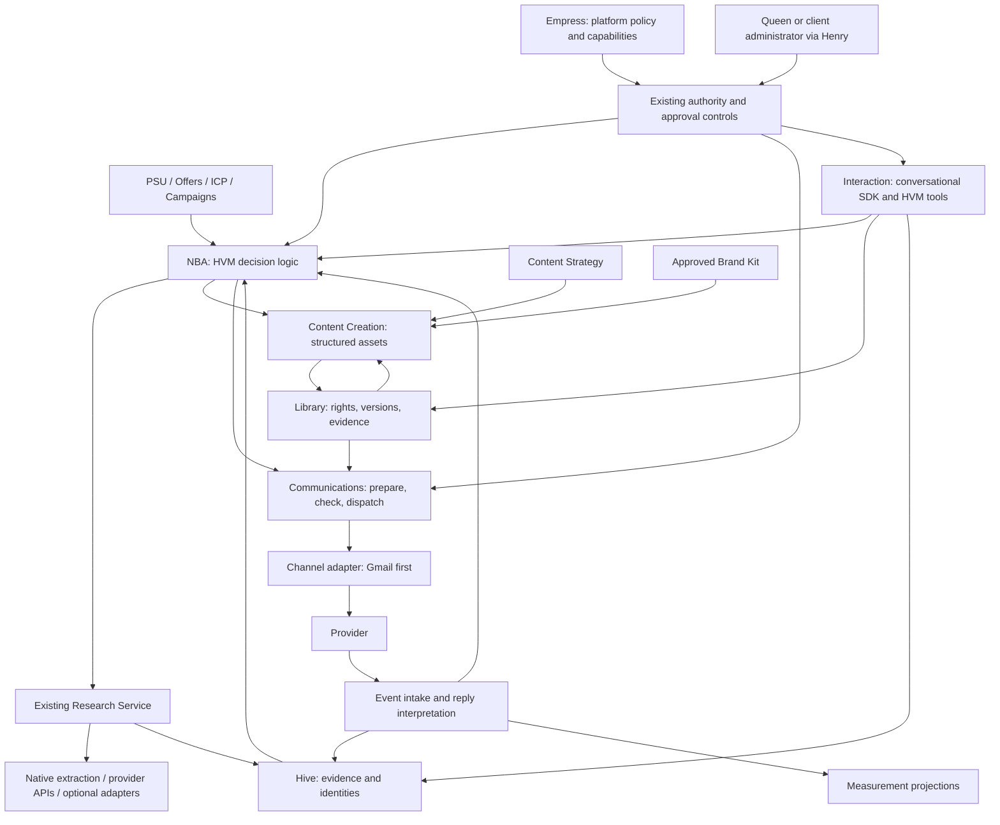

# HVM target execution architecture

Proposed on 16 October 2026; not implemented by this audit. Read alongside [current state](HVM_EXECUTION_CURRENT_STATE.md) and [decisions](HVM_BUILD_VS_REUSE_DECISIONS.md).

## Recommended boundary

Keep HVM's current TypeScript application, Mongo/Hive authority, capability catalogue, ECS/SQS control plane and Research Service. NBA owns marketing decisions. Communications executes authorised communication requests. Content Creation returns assets. Research returns evidence. Interaction handles conversations. Deterministic services own delivery, validation and record mutations.

A shared execution/control contract is desirable. A wholesale common agent-framework migration is not. Use an established conversational SDK for the new Interaction loop; do not rebuild tool streaming/history orchestration from scratch. LangGraph remains a bounded evaluation option if durable conversational branching exceeds the simpler SDK, not a prerequisite for outbound.

Arrows are authorised service calls/events, not permission to read all data. Visitors can access only explicitly publishable knowledge; an authenticated operator's context is different. External provider outputs are untrusted evidence, never authority.

## NBA: two modes, one arbitration policy

**Campaign acquisition:** assess the campaign goal and capacity; discover organisations; check Hive and engagement ownership; reuse current evidence; research gaps; enrich only if necessary; choose an offer and eligible contact/action. **Managed relationships:** respond to new evidence, replies, meetings and scheduled reviews without rediscovering the same organisation or restarting outreach.

Persist a campaign research frontier, per-organisation findings/freshness, contact engagement ownership and durable decisions. These are logical records to integrate into the existing model, not a mandate for one new collection per concept. Store the decision's approved context versions, evidence references, reason, alternatives, due time, outcome and any approval requirement. Missing evidence can produce a research request or a human question rather than an email.

Arbitrate across campaigns/offers at workspace level. The same person should not independently enter conflicting sequences; organisation-level coordination also matters when different employees are approached. Matching within a workspace is not permission to reuse another client's records. Allow authorised existing contacts to satisfy prospecting requirements without new Lusha charges.

Run finite work units through existing run/lease/checkpoint/dispatch controls. Persist future work and resume on due time or relevant events. Extend existing scheduling instead of a model continually running. Qualify the NBA composition and capacity bindings: today's legacy worker is not already an NBA deployment. Define pause/resume/cancel semantics, fair campaign scheduling and reconciliation after process death.

Customer Lusha limits govern paid enrichment independently from email volume. Reserve/reconcile credits, stop on unknown charge outcomes, respect per-day/account limits and resume at a verified refresh. Do not force spending merely to exhaust a monthly balance; spend toward authorised campaign demand. Keep AI usage accounting, bounded retries and loop detection without arbitrary AI-call or monetary quotas.

## Communications and email

NBA chooses the authorised channel/action within campaign policy. Communications validates it, obtains or requests the approved asset, resolves recipient/sender, renders, rechecks current suppression and authority, then claims dispatch. It does not invent another offer or turn a follow-up into a newsletter.

Logical progression: `requested → preparing → review_required/ready → dispatching → accepted/unknown/failed → observed outcomes`. A send-unknown is not safe to retry blindly. Reconcile provider message/thread identity and stable Message-ID first; escalate uncertainty. A Gmail accepted response is not evidence of inbox delivery. Keep dispatch history immutable while permitted content drafts remain editable.

Use Gmail's working adapter first. Add production send/sync paths separately from connection tests, preserving `testOnly` segregation. Google approval is a real rollout dependency; Microsoft gets its own OAuth/adapter verification later. Templates can be rendered with React Email without moving transport to Resend. MIME parsing can use MailParser, with output sanitisation and size limits.

For reply handling, deterministic processing verifies source, deduplicates messages and correlates tenant, sender account, provider thread/message and outbound communication. Preserve original content securely; isolate the new message, auto-response headers and attachments. Quoted text and signatures are evidence, not commands.

Suggested interpretation contract:

| Field | Meaning |
|---|---|
| `classification` | interested, question, objection, not_now, declined, unsubscribe, out_of_office, departed, referral, bounce, unknown; allow multiple labels |
| `evidence` | Message reference and short supporting spans for each material finding |
| `confidence` / `needsReview` | Calibrated uncertainty, never a permission grant |
| `signals` | Buyer need, competitor/alternative, requested timing, referral, qualification evidence |
| `proposedChanges` | Scoped contact/employment or follow-up proposals, not unreviewed overwrites |
| `nextReviewAt` | Explicit date or uncertain timing; never guess a date from vague wording |
| `interpreterVersion` | Model/prompt version and source provenance |

Unambiguous unsubscribe requests stop further sends through the suppression path immediately; uncertain requests hold outbound pending review. An out-of-office reply does not count as buying interest. “Left the company” marks the employment/email route as invalid and stops sending there; retain the person for future verified employment. A model should not automatically transfer identity or erase history. Human replies, including objections, reach NBA with evidence. Interpretation can be one structured call when rules are insufficient, not an autonomous email agent or per-field judge chain.

## Content, Library and CTA selection

Before the first campaign, qualify website ingestion and direct uploads against actual assets. Reuse original uploads, provenance and restrictions. A useful internal document is not automatically publishable. A CTA resolver must choose an existing live public page relevant to the selected offer, audience and stage, check its status/rights and record the asset/version/destination. Different messages may choose different pages. If no suitable destination exists, return a clear gap; do not invent a URL or leak a signed private-file URL.

Content Creation accepts the existing approved execution brief plus current authorised PSU/Offer/ICP/Campaign/Brand Kit/Library context. Return structured subject, body, CTA selection, evidence references and review flags. British English is default; apply current approved brand guidance in the original generation. Preserve proper names and facts. One targeted draft call is the starting point; no mandatory second judge or writer team.

Queen review/test-one-contact is a first-class user route. It uses real campaign prerequisites and renders the same asset as production, but sends only to an explicitly authorised test destination and cannot silently enrol the prospect. Approval binds the displayed content/version. Any later automated sending policy must explicitly define what it authorises.

Broader article, landing-page, social and guide outputs reuse this handoff/return architecture and document generators. External production remains an option. Content Creation never publishes or distributes merely because generation succeeded.

## Interaction

Use a maintained TypeScript conversational SDK (Vercel AI SDK is the first candidate) and accessible React chat components. Keep conversation storage, identity, authorisation and tool execution in HVM. Stream answers and expose recoverable tool progress. An anonymous session cannot look up private contact history by supplying an email address; use verification before sensitive continuity.

Retrieve only approved public knowledge. Natural information collection creates proposals/records through authorised Hive functions. Delivering a requested guide goes through Communications; optional further marketing is a separate policy decision. Persist handoff state and resume after an action completes. Henry's authenticated operator UI remains separate from the public visitor's permissions even if they share SDK primitives.

## Shared contracts, without another service

Extend the existing registry/Integrations and service-local interfaces. Mandatory envelope: schema version, server-derived workspace/brand, requesting actor/service, capability/version, request/correlation/idempotency identifiers, validated input, authority reference, deadline/cancellation, result status, structured error/retry disposition and audit timestamps. Authorisation is verified by HVM; a request's `permissions` array is not proof.

Capability-specific: campaign/offer/contact references; evidence/freshness/confidence; model usage; external charged/estimated/unknown units; asset rights; provider message IDs; consent/approval snapshot. Successful partial findings remain available with explicit gaps. Outbound side effects require stronger reconciliation than read-only research.

Native functions, direct APIs/SDKs, MCP tools and future A2A providers implement these same service boundaries. No generic remote code execution and no automatic marketplace discovery in production. Pin provider/version/tools; scope tenant credentials; validate destinations and outputs; require cancellation, retention and idempotency behaviour. A2A task completion returns findings, not automatic permission to mutate Hive or send mail.

## Measurement, tracking and advertising

Use an append-only, tenant-scoped event contract with stable event identity, occurrence/receipt times, communication/campaign/offer/person/organisation references where known, source and provenance. Project into current Mongo-backed campaign reporting; deduplicate intake and tolerate out-of-order events. Add an outbox/inbox pattern around durable state changes where needed. Exactly-once business effects are the target; external transport is not assumed exactly-once.

Track click redirects with opaque, expiring/scoped tokens mapped server-side. Do not put email addresses in URLs. Revalidate allowlisted destination and separate automated link scanning from credible engagement. Website identity is not proven merely by a forwarded link; anonymous visits stay anonymous unless there is a justified association. Open signals are optional, unreliable evidence and cannot alone qualify a lead. Booking, attendance, qualified opportunity and customer are distinct events; keep the existing external booking destination initially.

Use reusable charts and OpenTelemetry correlated with existing logs/usage. Redact prompts, credentials and message bodies by default. Marketing analysis consumes defined aggregates and links recommendations back to evidence; it does not automatically change budgets or policy. A statistical anomaly is not a causal conclusion.

Advertising later uses official account APIs, separate budget authority and platform-specific events. Providers retain auction/bid optimisation; HVM decides proposition/audience objectives and governed changes. Anonymous impressions cannot be counted as known contacts. Sponsored AI channels require a confirmed provider contract and access; A2A is not assumed to be their delivery API.
