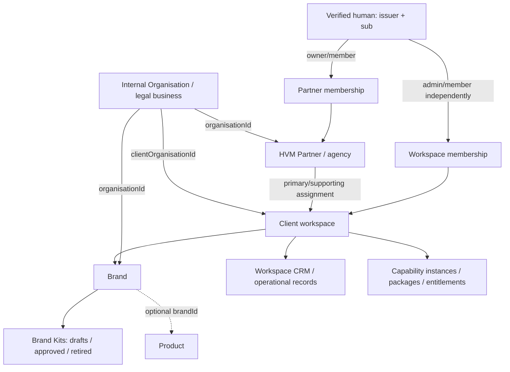

# Offering / ICP / Buyer Profile: current API and Hive architecture

Investigation date: **2026-09-29**. Repository: `vamberic-platform-api`; inspected working-tree source, with HEAD `752a59d9a8465a42bdb6c26ff94fedd850b322e7`. This is a source investigation, **not a live database inventory or deployment verification**. No AWS/Mongo calls, migrations, application edits, schema changes or new domain objects were made for this investigation. Existing checkpoint work is outside this document's change set.

Source links below are relative to this document. “Implemented” means executable code exists; “HTTP-exposed” means mounted in `src/app.ts`/routes; neither implies deployed. Pure validators and internal service functions are not described as live agents or public CRUD APIs. Searches covered application source, domain/DB/services, generated API contracts, Vapp, workspace libraries, scripts/tests and docs; ignored dependencies/build artifacts/local operator manifests were not treated as architecture. Historical documentation sometimes describes a future stage that current code has since implemented; executable code takes precedence.

## 1. Executive Summary

- The active Hive persistence layer is **MongoDB through the native Node driver**, using the fixed database name `vamberic_studio`. There is no separate Hive service/database abstraction: the term describes shared domain data in this API. A PostgreSQL/Drizzle package remains as unused scaffolding, with an empty schema export and no application imports found.
- **Organisation is the business/company identity; `crm_workspaces` is the client ownership boundary.** A client workspace references an internal Organisation via `clientOrganisationId`. An Organisation can also be an HVM Partner's legal/business reference. Neither Organisation identity nor Partner identity alone grants access.
- Portfolio **Products are not HVM client accounts, operational agents, or commercial packages**. A Product can represent a service/agency/customer-facing application and optionally belong to a Brand/workspace. The active Vapp Product API is internal-only. Reusing Product for every client's future Offering would collide with existing semantics and global slug uniqueness; this is a constraint to resolve, not a decision to create another entity here.
- There are **no canonical Offering, ICP/IAP or Buyer Profile collections/schemas**, and no implemented Lead Generation agent/runtime. There are existing `targetAccount`, `icpTier`, `persona` and buying-role annotations, plus real company/person/contact records. These are classification/results attached to CRM subjects, not reusable targeting definitions.
- Reusable foundations include canonical prefixed IDs, workspace authorization, transactional scoped HVM writes, optimistic concurrency, field evidence/observation protection, external references, Brand Kit approval and capability dependency validation. None is a general versioned knowledge graph, agent-run engine or downstream invalidation system.
- The largest implementation trap is assuming a persistence schema implies a usable HVM writer. `createCrmRecord`/`updateCrmRecord`/`observeCrmField` deliberately **reject workspace-scoped writes**, while the HVM router has a separate narrow transactional write path. Future scoped objects cannot safely be attached to the generic internal writer without an explicit authorization integration.
- Offering, ICP and Buyer Profile design is deferred. The later design must first settle the relationship between factual client offerings, portfolio Products, client Organisation references and workspace/Brand scope. The future Offer/Offer Agent is not designed in this report.

## 2. Database Architecture

### Runtime, configuration and schema authority

| Concern                      | Current implementation and source                                                                                                                                                                                                                                                                                                                                                                   |
| ---------------------------- | --------------------------------------------------------------------------------------------------------------------------------------------------------------------------------------------------------------------------------------------------------------------------------------------------------------------------------------------------------------------------------------------------- |
| Active database              | [`services/mongo.ts`](../../artifacts/api-server/src/services/mongo.ts): `MongoClientService`, native `MongoClient`, `DATABASE_NAME = "vamberic_studio"`; lazy reusable connection, 5-second connect/server-selection timeouts. No Mongoose/ORM model layer.                                                                                                                                        |
| Runtime config               | [`config.ts`](../../artifacts/api-server/src/config.ts), [`index.ts`](../../artifacts/api-server/src/index.ts), [environment example](../../artifacts/api-server/.env.example). `MONGODB_URI`, `DEPLOYMENT_ENV`, `NODE_ENV`, Cognito/region and feature config validated with Zod. An example env file is not itself a secure loader.                                                               |
| Dev operator config          | [hvm-partners.md](../hvm-partners.md): profile `vamberic-admin`, eu-west-2, existing Secrets Manager secret `vamberic/dev/api`; pass URI only into child process environment. Runtime ECS secret injection is owned by sibling infrastructure. No secret values are part of the domain model.                                                                                                       |
| Persistence schemas          | `artifacts/api-server/src/domain/*.ts`: Zod, inferred TypeScript types and pure relationship validators. [`db/collections.ts`](../../artifacts/api-server/src/db/collections.ts) provides typed Mongo collections and canonical index definitions. Code-first, with intentionally unequal enforcement coverage across older/newer collections; not uniformly schemaless or fully database-enforced. |
| Mongo validators             | `db/{crm,commercial,partner,onboarding,brand,hvm}-validators.ts`: manually maintained Mongo `$jsonSchema`/expressions, not generated automatically from Zod. CRM additions intentionally tolerate unknown legacy fields; newer definitions constrain more structure. Mongo cannot enforce cross-collection foreign keys.                                                                            |
| Separate unused SQL scaffold | [`lib/db/src/index.ts`](../../lib/db/src/index.ts), [`schema/index.ts`](../../lib/db/src/schema/index.ts), [`drizzle.config.ts`](../../lib/db/drizzle.config.ts): pg/Drizzle and `DATABASE_URL`; empty schema exports. No active domain tables or runtime imports found. Do not mistake `push`/`push-force` here for Hive migration tooling.                                                        |

### Migrations and constraints

Canonical command: `pnpm --filter @workspace/api-server db:setup --dry-run` or `--apply`, **with secure environment loading**, implemented in [`commands/db-setup.ts`](../../artifacts/api-server/src/commands/db-setup.ts). Neither was run here. `planDatabaseSetup` is read-only; `setupDatabase` creates missing collections, applies compatible validators with `collMod`, creates missing indexes, and writes the schema ledger last. It rejects incompatible/newer versions, validator/index conflicts and unresolved unique-index risks; aggregate duplicate checks can report unable-to-confirm rather than guessing safety.

The current code target is **schema 5**, ledger collection `schema_versions`, singleton `_id: "vapp-v1"`. Migration identities cover baseline v1, CRM foundation v2, commercial foundation v3, Brand foundation v4, HVM Phase 1 v5. This is a cumulative declarative setup plan, not an arbitrary up/down migration runner. DDL is sequential and **not one atomic transaction**: a failed apply can leave completed collections/validators/indexes before the final version write. Reinspection is necessary; compatible completed work is recognized on a later plan. It does not automatically drop/rebuild incompatible indexes or rewrite all documents. Applying validators does not establish that every historical record/reference has been fully semantically validated.

Product data normalization is a distinct reviewed command, `db:migrate-products`, backed by [`domain/product-migration.ts`](../../artifacts/api-server/src/domain/product-migration.ts); read compatibility is through `readProduct`/`normalizeProduct`. Legacy values and warnings are retained. A known Product ID/legacy-state mapping is deliberately narrow, not a generic inference about all paid software.

### IDs, dates, deletion and relationships

- IDs are strings such as `org_<26 lowercase Crockford ULID characters>`, generated by `generatePlatformId`/`generateUlid` in [`domain/ids.ts`](../../artifacts/api-server/src/domain/ids.ts). Prefixes are an explicit allowlist. Mongo-generated `_id` is internal and stripped from public/domain views; no arbitrary ObjectId is a domain foreign key.
- Base persisted fields: `id`; optional `workspaceId`; required `createdAt`, `updatedAt` as **BSON Date / Zod Date**; `schemaVersion` default 1; `archived` default false; optional `archivedAt`, `createdBy`, `updatedBy`, `source`. Defaults are Zod parsing defaults, not automatic Mongo defaults. HTTP DTOs serialize dates as ISO strings; some Product launch dates are deliberately date-only strings.
- Base `schemaVersion`, global DB schema version, `productModelVersion:2` and `updatedAt` are different concepts. None is a universal immutable business revision number.
- Archive state is conventional, not middleware that magically filters every Mongo query. Vapp CRM readers usually filter `archived: {$ne:true}`; Product listing behavior and stateful membership/kit/integration readers differ. Explicit lifecycle enums coexist with archive flags.
- References are scalar IDs/arrays of IDs, relationship collections, and nested value objects. Referential/same-workspace consistency is checked by specific services/pure validators. Direct driver writes bypass those checks; typed collection handles are not security boundaries.
- Collections use plural `snake_case`; fields/functions use `camelCase`; schemas/types use PascalCase; statuses are string enums usually snake_case. Enums are Zod literals/constant arrays, mirrored in Mongo validators where applicable; no universal reference-data collection.
- Documents commonly embed bounded arrays/objects (addresses, evidence, Brand content, stage definitions, capability dependencies). Arbitrary data is restricted to explicitly chosen fields; no universal EAV/custom-property engine exists.

### Transactions and audit

`MongoClientService.withTransaction` uses Mongo sessions, snapshot read concern, majority write concern and a 10-second commit limit. Enquiry ingestion, HVM onboarding, operator provisioning, internal CRM foundation writes and guarded hard deletion use transactions. Simple Product CRUD does not share the same audit/transaction/concurrency pattern. The driver may retry transactional conflicts; enquiry insertion also has a bounded duplicate-key retry loop. Notifications run after commit, best effort, without retrying persistence. No general durable outbox/worker is implemented.

## 3. Tenancy and Ownership



Arrows above express references/access paths, not cascades or inheritance of ownership.

| Concept                 | What actually exists                                                                                                                                                                         |
| ----------------------- | -------------------------------------------------------------------------------------------------------------------------------------------------------------------------------------------- |
| Organisation / company  | `organisations`, `OrganisationSchema`; real businesses, prospects/customers/partners/vendors, optional parent hierarchy. Can be internal registry identity or workspace-local CRM company.   |
| Client / tenant         | No separate `clients` entity. `crm_workspaces.kind="client"` plus `clientOrganisationId`; no workspace nesting. `kind="portfolio"` has no client Organisation.                               |
| Account                 | No general account entity. Provider account/tenant IDs identify external integrations/mappings; Partner operating account is an HVM Partner, not a Cognito user or customer billing account. |
| Brand                   | `brands`, required workspace and Organisation; multiple Brands per workspace, unique `(workspaceId,slug)`. Not a separate tenant.                                                            |
| Product                 | Portfolio commercial/customer-facing context; optional workspace/Brand. A Product link is not an authorization grant or tenant ID.                                                           |
| Project / business unit | No canonical Project or BusinessUnit entity/schema/collection found. Organisation parent hierarchy is not an implemented project system.                                                     |

Internal scope means **field absent**: `INTERNAL_SCOPE = {workspaceId: {$exists:false}}`. Null/empty/malformed scope is not internal. HVM workspace records require exact canonical scope; cross-workspace sharing needs an explicit future grant, not inference from common Organisation, email, domain or Product.

[`middlewares/auth.ts`](../../artifacts/api-server/src/middlewares/auth.ts) verifies Cognito RS256 signature/JWKS, configured issuer, expiry, required claims and access `token_use`, then binds verified `client_id` to `vapp` or `hvmapp`. Headers/custom claims cannot select an application. Human identity is `(issuer,sub)`; it is not the `person_…` CRM ID. Optional Person links in memberships are separate.

[`services/hvm-context.ts`](../../artifacts/api-server/src/services/hvm-context.ts) re-reads active unarchived memberships, Partners, assignments and client workspaces. Partner owner grants scoped admin; Partner member grants onboarder. Independent workspace admin/member grants admin/viewer. A human can legitimately have both Queen and Client perspectives. One Partner can manage many assigned client workspaces and own a separate client workspace; active primary assignment is unique per workspace, supporting assignments are permitted. Neither Partner registration nor entitlement alone grants human access.

[`authorization/policy.ts`](../../artifacts/api-server/src/authorization/policy.ts) creates trusted, authority-issued contexts (WeakSet protected). Vapp humans can access internal scope only. HVM viewers read; admins read plus specifically allowed Brand/kit/integration/workspace mutations and membership management; onboarders cannot approve/manage team. Agent/system contexts require explicit application/resource/action/scope grants. Current HTTP auth only authenticates humans; workload context support is a server-side seam, not a deployed service-token flow.

Cardinality constraints are not all present: there is no global unique Organisation name/domain, unique Partner-per-Organisation, or unique client-workspace-per-Organisation constraint. Existing provisioning can model self-client relationships, but multiple instances under regenerated IDs are not generically prevented by names. See §15.

## 4. Company / Client Model

### Complete Organisation field inventory

Source: [`OrganisationSchema` in schemas.ts](../../artifacts/api-server/src/domain/schemas.ts). R = required persisted input unless noted default; O = optional. In addition to the base fields below, there is **no universal dynamic custom-fields bag** on Organisation.

| Field                    | Presence / validation / meaning                                                                                                                           |
| ------------------------ | --------------------------------------------------------------------------------------------------------------------------------------------------------- |
| `id`                     | R; canonical `org_…` ID.                                                                                                                                  |
| `workspaceId`            | O; canonical workspace. Absence means internal, not shared with every tenant.                                                                             |
| `createdAt`, `updatedAt` | R; Date. Service manages update concurrency; base schema alone does not universally enforce chronology.                                                   |
| `schemaVersion`          | Default 1, positive integer.                                                                                                                              |
| `archived`, `archivedAt` | Default false / O Date. Separate from lifecycleStatus.                                                                                                    |
| `createdBy`, `updatedBy` | O `{type:human                                                                                                                                            | agent    | system     | integration,id?:string≤300,reference?:string≤300}`. Base actor lacks issuer.      |
| `source`                 | O `{system:string(1..100),reference?:string≤500,importedAt?:Date}`.                                                                                       |
| `name`                   | R; trimmed nonempty ≤300.                                                                                                                                 |
| `legalName`              | O string ≤300; separate from name, not required by schema. Provisioning's explicit legal `organisationName` populates **name**, not legalName.            |
| `description`            | O string ≤10,000.                                                                                                                                         |
| `website`                | O HTTP(S) URL ≤2,048, no embedded credentials.                                                                                                            |
| `normalizedDomain`       | O normalized ASCII/lowercase hostname ≤253, validated via `normalizeOrganisationDomain`; not a URL.                                                       |
| `domain`                 | O trimmed string ≤253; older identity/search/ingress field, weaker validation than normalizedDomain. No automatic universal synchronization between them. |
| `address`                | O strict object: optional `line1`,`line2` ≤300; `city`,`region` ≤200; `postalCode` ≤50; `countryCode` uppercase two letters.                              |
| `industryGroup`          | O string ≤200.                                                                                                                                            |
| `industry`               | O string ≤200; distinct older field, not a governed industry taxonomy.                                                                                    |
| `foundedYear`            | O integer 1..9999.                                                                                                                                        |
| `linkedinUrl`            | O validated HTTP(S) URL on linkedin.com/subdomain.                                                                                                        |
| `parentOrganisationId`   | O `org_…`; service checks parent existence, scope and cycles with bounded traversal.                                                                      |
| `revenueBand`            | O string ≤100; no fixed band enum.                                                                                                                        |
| `annualRevenue`          | O strict `{amountMinor:nonnegative safe integer,currency:supported ISO code,observedAt:Date}`.                                                            |
| `telephone`              | O strict `{label:main                                                                                                                                     | support  | sales      | other,value:nonempty string≤100}`; business telephone, not a Person ContactPoint. |
| `size`                   | O object with optional `employees` nonnegative integer, `band` ≤50.                                                                                       |
| `country`                | O trimmed string ≤2; older representation, weaker than address.countryCode.                                                                               |
| `region`                 | O trimmed string ≤100; distinct from address.region.                                                                                                      |
| `type`                   | R enum `prospect                                                                                                                                          | customer | partner    | vendor                                                                            | other`. |
| `lifecycleStatus`        | Default `active`; enum `active                                                                                                                            | inactive | archived`. |
| `fieldEvidence`          | O ≤200 observations; exact shared structure and protections in §10.                                                                                       |

Top-level Organisation Zod object is **not strict**: default parsing strips unknown keys. The additive Mongo validator does not enforce every Organisation field or relationship. Do not equate either with arbitrary accepted API fields; strict service patches and reference checks are a separate layer.

### Ownership and relationships

Organisation is referenced by employment (`organisation_relationships`), Product relationship, Opportunity, subscription/entitlement/transaction customer identity, events/tasks/leads, Brand, Partner and client workspace. Parent Organisation expresses a business hierarchy, not an access hierarchy. The internal client Organisation registry and the workspace's target/customer-company data may both use this collection with different scope. Generic CRM references require exact scope; the client-workspace → internal Organisation registry reference is an explicit exception. Brand validators permit same-workspace or internal Organisation references in their checked graph; the HVM route derives the client Organisation from the workspace, not browser-supplied ownership.

### Actual lifecycle/read/write paths

1. **Public ingestion:** [`services/enquiries.ts`](../../artifacts/api-server/src/services/enquiries.ts) creates/reuses company/contact records using source-specific dedupe and transaction checks. Internal ingress uses `public_enquiry`; explicitly configured workspace ingress uses `workspace_public_enquiry`. The routing config selects workspace/Brand server-side, never a caller-supplied tenant field. This is not a general company import/enrichment endpoint.
2. **Operator client registration:** `provisionHvmClient` requires schema 5, stable reviewed IDs and a trusted issuer. It reuses an active internal Organisation or creates one when explicitly named, with `type:"customer"`; creates Partner, memberships, workspace, assignment, Brand and an audit event transactionally. Existing name/state mismatches fail. No email-inferred memberships, billing, integrations or Brand Kit seeding. The command has apply-only CLI, no native dry-run.
3. **Internal write helper:** `createCrmRecord`/`updateCrmRecord` validate strict patches, merged schemas, evidence and referenced records under a transaction; preserve original source and immutable scope; use `updatedAt` optimistic checks and monotonic timestamps. This is not mounted as generic Organisation POST/PATCH. It rejects workspace input. Callers must provide a trusted actor/authorization boundary; a parsed `actor` object alone is not authentication.
4. **Reads:** `/api/v1/organisations` and `/:id` are Vapp/internal-only. List supports literal escaped name/domain search and offset pagination. `crmReader` produces selected fields, linked people, Product relationships, opportunities and recent events, rather than returning the complete persistence object. HVM reads its client Organisation's limited identity through workspace overview; there is no general HVM company CRUD route.
5. **Updates in HVM:** `POST …/workspaces/:workspaceId/profile` changes the **workspace name**, not Organisation legal identity. Brand create/update uses the existing client Organisation. No general HVM legal-company editor is implemented.
6. **Archive/delete:** schemas/helpers allow lifecycle/archive representation, but there is no generic public Organisation archive endpoint. Guarded internal hard-delete preview/DELETE exists for CRM test/enquiry records. It blocks meaningful/customer/partner, financial, task/lead, workspace, Brand, Partner, child Organisation and other protected history rather than blindly cascading. See `services/crm-delete.ts` for the full dependency plan. It is not a client-offboarding operation.
7. **UI:** `artifacts/vapp/src/pages/crm/index.tsx` shows internal Organisations/People/Opportunities; delete preview/danger-zone components use guarded deletion. HVM frontend is a sibling repository, not implemented in this API repo; its current API consumer contract is documented in `docs/hvm-phase1-backend.md` and `docs/hvm-deployment.md`.
8. **External/agents:** `external_references` can map an Organisation to a provider/account object. No current Lusha/HubSpot sync or Lead Gen consumer fetches/updates Organisation automatically. Source/evidence/internal helpers are building blocks only.

**Suitability observation, not final schema design:** Organisation is the existing real-business reference, but by itself is not sufficient tenant ownership for future client Offering records. The correct internal-client-registry versus workspace-local-company relationship must be explicit. Nothing currently provides an Organisation → Offering collection relationship.

## 5. Existing Product / Service / Offering Concepts

### Product (active portfolio API)

[`ProductSchema`](../../artifacts/api-server/src/domain/schemas.ts) inherits base fields; adds optional `brandId`, `productModelVersion` default/literal 2, required name≤200 and slug (2..100 lowercase hyphen pattern), optional description≤10,000, internalNotes≤20,000, legacyProductData object, migrationWarnings string array.

Required nullable fields: `productType` and `lifecycleStatus`. Product types: `software`, `consumer_app`, `marketplace_app`, `service`, `agency`, `content`, `website`, `experiment`, `other`. Lifecycle: `idea`, `building`, `pre_launch`, `live`, `paused`, `retired`.

Nullable default-null fields: `operatingMode` (`active|maintain|listen`), `businessModel` (`saas|professional_services|transactional|marketplace|advertising|content|lead_generation|other`), `primaryDomain`, date-only `plannedLaunchDate`/`actualLaunchDate`, `launchHypothesis`, `successMeasures`. `revenueModels` defaults empty, unique max9: `one_off|subscription|retainer|usage|marketplace|advertising|commission|free|other`. `additionalDomains` defaults empty max50; `currency` optional nullable ISO currency. Domain validation here is less strict than Brand/normalized Organisation domain.

Active readers/writers: `routes/products.ts` GET list/detail, POST, PATCH; `routes/dashboard.ts`; `domain/product-migration.ts`; Vapp Product list/detail/form/portfolio summaries; enquiry validation and commercial relationships. Internal filters prevent HVM raw Product CRUD. `products.slug_unique` is globally unique, not workspace-qualified. There is no Product `organisationId`; ownership associations must not be inferred from `product_relationships` (which describes prospect/customer/partner relationships). Optional Brand/workspace relationships exist at persistence/graph validation level, not equivalent to an exposed client catalog editor.

The word “offering” in docs sometimes describes a portfolio Product in ordinary language. No `OfferingSchema`, `offerings` registry or formal Offer entity was found. No separate Service/Solution/Proposition/SKU/BusinessUnit schema was found. `Subscription.plan` is a bounded label, not a plan catalog.

### Brand and Brand Kit

[`domain/brands.ts`](../../artifacts/api-server/src/domain/brands.ts): Brand has required id/workspace/Organisation/name/slug/status (`active|retired`), optional primaryDomain/description and base metadata. Brand Kit has required id/workspace/brand/status (`draft|approved|retired`), optional approvedAt/approvedBy, arrays assets/colours/typography (default empty), optional visualRules, voice, terminology, descriptions, imageryGuidance, emailDefaults. Asset objects hold store/bucket/key/optional versionId references, not uploads. Voice can include audience-specific text; descriptions can reference actual Product IDs of the same Brand/workspace. These are identity/guidance, not account targeting definitions or Offering facts.

Only `(workspaceId,brandId)` with `status:"approved"` is unique. Draft/retired records can coexist. `readCurrentBrandKit` authorizes workspace and Brand, requires an active Brand, selects at most one approved unarchived kit and filters retired assets. HVM kit create/update/approve/retire operations are actual transactional routes; approval retires previous approved kits. No full immutable revision system or automatic downstream regeneration exists.

### Commercial and capability models (not Offering substitutes)

Source: [`commercial-records.ts`](../../artifacts/api-server/src/domain/commercial-records.ts), [`commercial.ts`](../../artifacts/api-server/src/domain/commercial.ts).

| Entity                 | Actual fields/semantics beyond base                                                                                                                                                                                                                                                         |
| ---------------------- | ------------------------------------------------------------------------------------------------------------------------------------------------------------------------------------------------------------------------------------------------------------------------------------------- |
| `capabilities`         | Global catalog, no workspaceId; name; nonempty unique `supportedScopeTypes` (`workspace                                                                                                                                                                                                     | product`); `dependencies:[{capabilityId,scope:same_scope | workspace}]`. Not a runtime agent.                                                                                                 |
| `capability_instances` | Required workspaceId, scopeType, capabilityId; scopeProductId iff product scope; status `draft                                                                                                                                                                                              | enabled                                                  | disabled`; unique dependencyInstanceIds; optional bounded configuration/output. Not an agent run record.                           |
| `commercial_packages`  | Required workspace/scope/name/nonempty capabilityIds; optional/default-empty instance IDs; status `draft                                                                                                                                                                                    | active                                                   | retired`; optional billingTreatment. Workspace commercial bundling, not a future marketing Offer or universal Offering definition. |
| `commercial_charges`   | Required workspace/name/chargeType/billingTreatment/status; instance and/or package target; recurring billingInterval iff recurring; usageUnit iff usage; optional explicit amountMinor+currency pair, billingReason/approvedBy, source subscription/transaction IDs.                       |
| `subscriptions`        | Product plus person and/or Organisation; provider, plan label, status, currency, recurring amount, billingInterval/start, external customer/subscription IDs and optional lifecycle dates.                                                                                                  |
| `entitlements`         | Exactly one Product/capability/capability-instance target; capability targets require workspace; internal grants require customer identity. activeFrom, optional activeUntil, status/type; commercial/billing/source links and optional scope/quantity. Grants, not prices or running jobs. |
| `transactions`         | Product/customer/provider, amounts in minor units+currency, type/status/time, external IDs and optional subscription/entitlement/campaign/original transaction refs. Status-only guarded update contract; not an implemented payment processor.                                             |

Billing treatment enum: `standard|bundled|waived|internal|promotional`. It does not itself grant capability access. Pure commercial validation checks reference scope, technical dependency consistency/cycles and valid entitlement windows; `hasCapabilityInstanceEntitlement` computes access for HVM capability reads. No catalog/package/charge CRUD, billing adapter, agent execution or Offer construction HTTP API is mounted. Tests/docs use Offer/Strategy/ICP/Lead Gen as illustrative capability names; those examples are not a shipped agent implementation or seeded catalog.

## 6. Existing ICP / Audience / Persona Concepts

No canonical ICP, IdealAccountProfile, BuyerProfile, audience-segment registry or executable target-query schema was found in `src/domain`, collection definitions, mounted routes or API spec.

Existing adjacent representations:

- `qualificationFields` on **ProductRelationship and CrmLead**: optional `targetAccount:boolean`, `icpTier:tier_1|tier_2|tier_3|outside_icp`, `persona:{reference?:string,label:string}`, lifecycle/lead status/reasons/owner/attribution. `persona.reference` is a bounded free string, not a validated foreign key to a persona collection. These express fit/qualification of an actual subject.
- `Opportunity.buyingRoles`: bounded `{personId,role}` array; role `decision_maker|champion|economic_buyer|technical_buyer|influencer|end_user|blocker`. People must be in opportunity.personIds; duplicate person-role pairs rejected. Actual participants, not reusable buyer archetypes.
- `Campaign.audienceDescription`: optional free text≤5,000, not a queryable segment definition or membership relation.
- Brand Kit `voice.audiences:[{audience,guidance}]`: editorial guidance. Does not define account/person targeting.
- Product `launchHypothesis`, `successMeasures` and descriptions: portfolio planning text, not ICP criteria.
- Commercial dependency examples for Strategy/ICP: scope and entitlement examples only. No output schema for a generated ICP exists beyond optional generic instance output metadata.

Absence of these schemas does not imply that a separate collection per conceptual box is now required; that design is deliberately left open.

## 7. Lead Generation Data Model

There is **CRM intake and qualification**, not an implemented Lead Generation research pipeline. The mapping of available facts is:

| Targeting concern             | Existing representation / limit                                                                                                                                                                                                                                                                                                                                                                                                                         |
| ----------------------------- | ------------------------------------------------------------------------------------------------------------------------------------------------------------------------------------------------------------------------------------------------------------------------------------------------------------------------------------------------------------------------------------------------------------------------------------------------------- |
| Actual target company/account | Organisation; workspace-local CrmLead points to person and/or Organisation. Internal ProductRelationship remains a separate commercial/CRM relationship.                                                                                                                                                                                                                                                                                                |
| Person/contact                | Person: firstName required; optional lastName/displayName/title, preferredLanguage/timezone/socialProfiles/evidence; lifecycle default active. ContactPoint: personId/type/value/normalizedValue, primary, validity, deliverability, leftOrganisation, suppressed, firstSeenAt/lastValidatedAt, label, sourceVerifiedAt/reason, optional employment relation. Email lowercase normalization; phone formatting stripped without inventing country codes. |
| Job/function                  | OrganisationRelationship: personId/organisationId, jobTitle, employmentRole, department, seniority, startDate/endDate, current default false, confidence 0..1, evidence. Person.title is not the same as employment jobTitle.                                                                                                                                                                                                                           |
| Firmographics/geography       | Organisation industry/industryGroup, size, revenue, address/country/region and parent; mostly strings and optional values, not provider query enums.                                                                                                                                                                                                                                                                                                    |
| Lead/prospect                 | CrmLead requires workspace and at least personId or organisationId; optional product/campaign and qualification/evidence. Organisation.type=prospect and ProductRelationship.status=prospect are different contextual concepts, not synonyms for one lifecycle field.                                                                                                                                                                                   |
| Qualification                 | salesLifecycleStage `lead                                                                                                                                                                                                                                                                                                                                                                                                                               | qualified | opportunity | customer | advocate | disqualified`; leadStatus `new | researching | ready | contacted | responded | nurture | closed`; owner/assignment date, targetAccount, icpTier/persona, reasons, next action/time. Omission means unknown, not automatically qualified. |
| Attribution/source            | Base source; first/latest attribution include channel, source, medium, campaignId, landing/referrer URL and observedAt; related campaign/time validation exists. Public submissions also carry bounded form/UTM evidence.                                                                                                                                                                                                                               |
| Enrichment                    | `fieldEvidence`, `observeCrmField`, provider-account external references. No crawler/enrichment-provider API execution.                                                                                                                                                                                                                                                                                                                                 |
| Campaigns                     | name/type/channel/status, audienceDescription, product/workspace context, dates/spend/currency/provider/reference/attribution. References from leads/relationships/events/opportunities/imports, not a generalized campaign membership list.                                                                                                                                                                                                            |
| Lusha/HubSpot IDs             | Generic `external_references` tuple and workspace integration account/tenant IDs; no special canonical Lusha person/company property and no executable Lusha adapter.                                                                                                                                                                                                                                                                                   |
| Handoff to CRM                | Existing public enquiry writer creates scoped CRM records transactionally. No candidate promotion queue, candidate→CRM approval workflow or external CRM sync/handoff implementation.                                                                                                                                                                                                                                                                   |

[CRM foundation documentation](../crm-foundation.md) explicitly separates future raw candidate/research populations from deliberate CRM admission; this is an architectural intent, not an implemented research storage subsystem. ICP criteria compilation, provider field translation, ranking/scoring, demand-signal evaluation and account discovery are not present. Future targeting must distinguish a reusable definition from observed company/person facts and classification outcomes; no design is chosen here.

## 8. CRM / Hive Data Model

Canonical collection inventory from [`db/collections.ts`](../../artifacts/api-server/src/db/collections.ts):

- Business/identity: `products`, `people`, `contact_points`, `organisations`, `organisation_relationships`, `product_relationships`.
- CRM: `opportunities`, `campaigns`, `crm_pipelines`, `crm_workspaces`, `crm_leads`, `crm_tasks`, `events`, `imports`, `external_references`, `marketing_permissions`.
- Commercial: `subscriptions`, `entitlements`, `transactions`, `capabilities`, `capability_instances`, `commercial_packages`, `commercial_charges`.
- HVM access/configuration: `hvm_partners`, `hvm_partner_memberships`, `workspace_partner_assignments`, `workspace_memberships`, `workspace_integrations`.
- Brand: `brands`, `brand_kits`. Schema ledger: `schema_versions`.

Opportunity contains Organisation, linked people, optional Product/workspace/campaign/pipeline, name/stage/status, amount/currency, probability, close/action/won/lost dates/reasons, description/owner/priority/dealType and buying roles/evidence. CrmPipeline has scoped name and bounded ordered stages with unique IDs/orders, stage status and optional probability; edits cannot invalidate linked opportunities. CrmTask is a bounded human/agent/system/integration-assigned CRM action (`call|email|meeting|research|follow_up|other`) with status, priority, dates and subject links, **not a durable job executor**.

`events` is the shared event/interaction collection; no additional CRM activity collection is canonical. Typed interaction details are in [`crm-interactions.ts`](../../artifacts/api-server/src/domain/crm-interactions.ts); events support subject/body/summary/actor, typed interaction details and attachment/recording references, plus subject IDs, occurrence time and bounded payload. Generic CRM events are append-only through the helper. Service audit events and Vapp operational log audits are different mechanisms; not every CRUD operation emits a persisted event.

MarketingPermission holds person/contact scope, optional Product/workspace or internal portfolio scope, channel, purpose, lawfulBasis, permitted, evidence, effectiveAt, optional supersedes/review. `resolveEffectiveMarketingPermission` resolves exact-scope history, excludes future decisions and breaks ties deterministically by effectiveAt/createdAt/ID. It is **not a complete outreach eligibility engine**. Contact deliverability/suppression and consent are separate. Discovery/enrichment does not create permission.

`external_references` maps `workspaceId? + provider + providerAccountId + objectType + externalId` to `entityType/entityId`; validates prefix/type and optional sourceCreatedAt/sourceUpdatedAt/lastSyncedAt. The unique index includes workspace and provider account. The entity allowlist is explicit, not every collection automatically. Brand/kit/Partner/integration/membership types are not currently in that allowlist. Historical provider-specific fields on subscription/transaction/campaign/import/event remain supported.

Extensibility exists selectively: Event payload, Campaign attribution, Import lawfulBasisPolicy, CapabilityInstance configuration/output use bounded metadata (≤50 keys, serialized ≤16KB). Import fieldMapping maps strings. Generic metadata is not an excuse to bypass strict domain/tenancy/evidence requirements; Organisation has no equivalent catch-all custom fields.

**Shared versus agent-specific boundary:** one shared Mongo domain store and central access policy are explicit. CapabilityInstance configuration/output may hold operational values, while CRM stores canonical contacts/business relationships. There is no separately enforced “agent knowledge store,” research namespace, job database or standard output promotion boundary. Documentation distinguishes research from CRM intent, but an executable universal boundary has not been built.

## 9. Agent Architecture

An `agent` currently exists as an actor discriminator in audit/CRM assignment and authorization types; capabilities/catalog/instances describe reusable functionality and workspace activation/dependencies. There is no `agents`, `agent_runs`, jobs or schedules collection, no Offer/Product Definition/ICP/Lead Gen code module, and no mounted generation/status-polling API found. `capability_instances.output` is an optional bounded object, not a typed generated artifact/version record.

`createAuthorizationAuthority().service()` permits a server-authenticated workload only when an explicit grant is configured. Production `app.ts` composes human Cognito bindings, not a generic agent authentication/dispatch system. CRM helper actor inputs do not authenticate an agent. `CrmTask.assignedTo.type="agent"` and Event actor metadata are representational support, not orchestration.

Reusable non-runtime pieces: commercial dependency graph/cycle and scope checks; entitlement evaluation; field evidence protection; Brand Kit human approvals; transactional domain services. No general agent change proposal, reviewer queue, automatic commit policy, model-provider configuration, token-cost ledger, retry scheduler, dead-letter queue or regeneration runner exists. Notification SES delivery is a bounded best-effort post-commit integration, not agent orchestration. Workspace integrations deliberately model client operational connections; OpenAI/model providers are not exposed as HVM client integrations.

## 10. Provenance / Evidence / Knowledge Quality

Strongest existing candidate is [`fieldEvidenceSchema`](../../artifacts/api-server/src/domain/crm-fields.ts), used by People, Organisations, employment relationships, ProductRelationships, CrmLeads and Opportunities:

```text
field: bounded dotted field path (up to 3 components)
value: bounded string | finite number | boolean | Date | socialProfiles | bounded flat value object
provider: nonempty string <=100
sourceReference: nonempty string <=500
observedAt: Date
verification: observed | provider_verified | human_verified | rejected
confidence?: number 0..1
```

Max 200 observations per record. `ENRICHABLE_FIELDS` is a per-collection/path allowlist; an observation's candidate value is validated by temporarily applying it to the target schema. Evidence history cannot be removed/rewritten by the foundation service. A nonhuman actor cannot newly assert `human_verified`. Verified evidence may fill an **absent** field; it does not overwrite an existing canonical fact. Changing an existing fact requires the explicit human-edit path. Nonhuman enrichment must use `observeCrmField`; original source cannot be silently replaced.

Limits: these guarantees hold for callers of that service, which currently rejects workspace-scoped writes. Other driver writers must enforce equivalent rules themselves. Evidence is not immutable at Mongo permission/schema level; there is no approval queue for arbitrary observations. There is no standard `AI inferred` category, explicit unknown fact record, citations document entity, evidence content hash or universal fact identity. Optional absent values and some contact “unknown” enums represent unknowns inconsistently across domains. Provider `observed` could record a source, but it must not be declared equivalent to the proposed future knowledge-quality taxonomy without design work.

Other reusable provenance: base `source`; import fieldMapping/policy/counts/status; external reference sync timestamps; employment confidence; contact verification metadata; enquiry submission evidence; permission history; BrandKit approvedBy/At. Base `actorSchema` lacks issuer, whereas `partnerHumanSchema`/authorization human includes issuer+subject; HVM event payload stores full human identity even when base createdBy strips issuer. No universal field-level user-confirmed versus AI-inferred convention currently exists.

## 11. Versioning / Dependency Patterns

| Pattern                           | Reusable fact                                                                                                                                  | Limitation                                                                                     |
| --------------------------------- | ---------------------------------------------------------------------------------------------------------------------------------------------- | ---------------------------------------------------------------------------------------------- |
| Brand Kit lifecycle               | Draft/current approved/retired records; partial unique approved index; transactional replacement; approved kits not silently edited as drafts. | Not globally immutable snapshots, numbered revisions, diff history or dependency invalidation. |
| `updatedAt` / `expectedUpdatedAt` | HVM mutations and internal CRM helper reject stale updates; workspace touch serializes onboarding operations.                                  | Write concurrency, not downstream semantic staleness.                                          |
| Capability dependencies           | Capability graph and scoped dependency instances; cycle/scope checks; access requires valid dependencies/entitlements.                         | Technical availability graph, not lineage of generated facts/content revisions.                |
| Evidence / permissions / events   | Append-preserving evidence, superseding permission history and append-only service events.                                                     | Different local patterns, not one revision/event-sourcing framework.                           |
| Delete preview hash               | SHA-256 of relevant dependency snapshots, verified again transactionally before guarded deletion.                                              | A delete safety token, not an Offering/ICP source fingerprint.                                 |
| Asset `versionId`                 | Optional S3 object-version reference.                                                                                                          | Asset storage version only.                                                                    |
| Schema/Product model versions     | Structural migration compatibility.                                                                                                            | Not editable business content revisions.                                                       |

No general immutable version table, source fingerprint, stale downstream flag, regeneration queue or cross-agent dependency tracking was found. Do not extrapolate those capabilities from `schemaVersion`, capability dependencies or the existence of Event records.

## 12. API Conventions

Node/Express REST-like API with some **operation-style POSTs**, not GraphQL. Composition order in `app.ts`: request ID and sanitized request logging, Helmet, isolated public enquiry router, authenticated origin CORS, rate limit, Cognito auth, HVM router, Vapp operational authorization, remaining routes, errors. CORS is not authorization. Health/readiness exceptions exist; business routes require trusted context.

| Surface          | Current behavior                                                                                                                                                                                                                                                                                                                                                            |
| ---------------- | --------------------------------------------------------------------------------------------------------------------------------------------------------------------------------------------------------------------------------------------------------------------------------------------------------------------------------------------------------------------------- |
| Vapp Products    | `/api/v1/products` GET/POST and `/:id` GET/PATCH, generated contracts plus domain validation. No generic Product DELETE route.                                                                                                                                                                                                                                              |
| Internal CRM     | People/Organisations/Opportunities GET list/detail; lists `{items,total,limit,offset}` and validated named filters, escaped literal search. No generic company/contact write API.                                                                                                                                                                                           |
| Guarded deletion | GET `/:id/delete-preview`, DELETE `/:id` for supported CRM types; explicit preview/confirmation and dependency conflict checks. Workspace records denied.                                                                                                                                                                                                                   |
| HVM context/read | `/api/v1/hvm/context`; `/integration-providers`; `/workspaces/:workspaceId/{overview,brands,integrations,team,capabilities,enquiries}`; Brand kit current/history endpoints. Resource-specific projections, not a universal envelope. Lists cap at 100 (fetch101 then conflict), not silently truncated pagination. Membership resolution bounded at200.                    |
| HVM write        | POST `/workspaces/:workspaceId/:operation`: profile, brand-create/update, kit-create/update/approve/retire, integration-create/update/disconnect, member-provision/revoke. Strict Zod bodies, scoped IDs, current server membership, transaction and optimistic timestamps. No general workspace/company creation route; operator provisioning owns initial graph creation. |
| Public enquiry   | Product-keyed unauthenticated endpoint, separate origin/rate/spam/strict payload checks, trusted routing config, generic accepted 201; cannot submit arbitrary CRM/enrichment/tenant fields.                                                                                                                                                                                |

OpenAPI in [`lib/api-spec/openapi.yaml`](../../lib/api-spec/openapi.yaml), Orval config and generated `lib/api-zod`/`lib/api-client-react` cover existing Vapp/public surfaces. **HVM routes are handwritten and not yet represented by generated HVM contracts in this spec.** Responses vary: generic middleware produces nested `{error:{code,message,details?}}`; some routes return `{error:string}`; HVM has its own sanitized validation/denial/conflict handling. Do not assume one envelope without checking consumers.

Validation occurs at request, persistence and selected database layers, but coverage differs. Generic update schema helpers are not themselves complete merged-record/reference validation. HVM uses server-derived ownership and actors; older Product paths have simpler behavior. HTTP DTO dates are strings while persistence validators require Dates. No background generation/run/job polling API exists.

Best examples for later work: HVM scoped route/mutation authorization; Brand strict schema plus cross-reference checks; foundation helper evidence protections as a pattern (not an immediately usable workspace writer); canonical `db:setup` registration/index preflight; explicit public safe projections. Avoid copying older unscoped paths or assuming every schema has CRUD.

## 13. Relevant Existing Design Patterns

| Example                         | Why useful                                                            | Ownership, references, validation and history                                                                                                                                                                                                  |
| ------------------------------- | --------------------------------------------------------------------- | ---------------------------------------------------------------------------------------------------------------------------------------------------------------------------------------------------------------------------------------------- |
| Brand / Brand Kit               | Closest current workspace-authored, human-reviewed structured content | `domain/brands.ts`, `services/brand-kits.ts`, `routes/hvm.ts`, `db/brand-validators.ts`. Mandatory scope, Organisation/Brand links, strict objects, approval invariants, partial uniqueness, transactional replacement. No full version graph. |
| Internal CRM evidence service   | Canonical fact versus observation protection                          | `services/crm-foundation.ts`, `domain/crm-fields.ts`. Allowlists, source/evidence preservation, concurrency, reference locks; service rejects workspace data and is not exposed as generic HTTP.                                               |
| Workspace/membership resolution | Authoritative tenant access and dual roles                            | `services/hvm-context.ts`, `authorization/policy.ts`, membership/Partner schemas and indexes. Fresh server reads, immutable human issuer/sub, no automatic permissions from business identity.                                                 |
| Capability / instance           | Separate definition from scoped activation                            | `commercial-records.ts`, `commercial.ts`. Typed IDs, explicit scopes and dependency graphs, distinct commercial versus technical constraints; lacks execution runtime.                                                                         |
| Public enquiry ingestion        | Atomic multi-entity write with consent/source discipline              | `services/enquiries.ts`, `db/enquiry-indexes.ts`. Source-scoped idempotent identity matching, workspace routing, transaction retry handling, post-commit notifications; not a generic write mechanism.                                         |
| CRM hard-delete                 | Dependency-aware destructive action                                   | `services/crm-delete.ts`, delete route/UI tests. Preview hashes, bounded dependency scan, transaction recheck, blockers; do not automatically extend cascades to new domain objects.                                                           |

## 14. Likely Future Integration Points

**Observations only — not final schema or collection recommendations.**

| Existing entity/service                           | Likely connection to investigate                                                         | Constraint                                                                                                                                                 |
| ------------------------------------------------- | ---------------------------------------------------------------------------------------- | ---------------------------------------------------------------------------------------------------------------------------------------------------------- |
| Client workspace + Organisation                   | Business owner and legal/company reference of client-authored Offering knowledge         | Workspace is the authorization boundary; Organisation ID alone is insufficient. Internal registry versus workspace prospect Organisation must be resolved. |
| Brand                                             | Brand-specific terminology, identity and current approved guidance                       | Workspace match, optional multi-Brand relationship needs a later decision; no invented hierarchy.                                                          |
| Product                                           | Link when a factual client offering also corresponds to a registered portfolio Product   | Do not conflate every client offering with portfolio Product, global slug or commercial ProductRelationship.                                               |
| CrmLead / ProductRelationship qualification       | Store/use later fit classification of actual subjects against defined ICP/Buyer criteria | Current icpTier/persona annotations lack typed definition/version foreign keys.                                                                            |
| Organisation / employment / Person / ContactPoint | Candidate fact inputs for matching account/person criteria                               | Canonical facts, contactability and consent are separate; strings/bands are not provider query parameters.                                                 |
| Field evidence / observation service              | Provenance and safe promotion pattern                                                    | Not yet a workspace writer or complete knowledge taxonomy.                                                                                                 |
| CapabilityInstance / entitlements                 | Future functionality activation and access dependency                                    | Not the canonical location for arbitrary foundational records merely because an agent creates them; no Offer scope currently supported.                    |
| Events / external references                      | Audit/source linkage of later authorized operations                                      | Existing allowlists, bounds and actor forms need explicit review; no universal lineage implementation.                                                     |
| HVM router / policy / setup                       | API ownership, registration, validation and migration seams                              | No automatic CRUD/resource registration. Every route, resource, validator/index and projection needs deliberate integration.                               |

No future Offer schema, Offer Agent behavior, ICP criteria syntax or Buyer Profile field design is proposed here.

## 15. Risks / Legacy / Technical Debt

**Factual findings:**

1. Two database technologies appear in the tree; only Mongo is active for this domain. SQL scaffold could mislead a new implementation.
2. Organisation `domain` versus `normalizedDomain`, `industry` versus `industryGroup`, and top-level country/region versus address fields coexist. Current ingress/search uses legacy fields; no universal canonicalization/backfill resolves the pairs.
3. Optional workspaceId supports internal and tenant-local records in the same collection. Null/missing are not interchangeable. Relationship helpers contain explicit exceptions; different writer paths are not interchangeable.
4. Zod strictness varies; older schemas strip unknown keys, newer strict objects reject them. Mongo validators are hand-maintained and partly additive. No complete schema-generation guarantee exists.
5. Foundation CRM writes reject workspace scope despite workspace-capable schemas. The raw service accepts typed actor input, not an authorization token/context. It must not be exposed directly.
6. Generic foreign keys/cascades are absent; reference validation is service-specific. `_crmReferenceRevision` is an internal locking counter on referenced records, not business version history.
7. Public dedupe is source-specific: internal email unique by normalizedValue+source; company by domain+name+source; workspace variants prepend workspace and use another source value. There is no universal unique company identity or all-source email uniqueness.
8. Product slug is globally unique; Product domain validation differs from Brand and Organisation. Product legacy normalization includes a narrow ID/state exception and compatibility reader; legacy fields are not the future house style.
9. Partner/workspace/Organisation names do not guarantee provisioning idempotency. Stable IDs and identity/state comparisons are essential. A rerun with new IDs can model duplicates despite some pair uniqueness constraints.
10. `schemaVersion` is not business revision history; archive flags are not universal deletion filters; Product, CRM and HVM audit/concurrency guarantees differ.
11. `EntitlementSchema` attaches target integrity; `EntitlementInsertSchema` additionally attaches active-window integrity. Pure commercial validation/access checks must not be replaced by assuming every persistence parse enforces the same time rules.
12. Authorization resource list uses `import_batches` while the actual collection/schema is `imports`. No mounted import HTTP route currently exercises this mismatch; new work must not copy the mismatch.
13. External-reference entity allowlist does not automatically include later Brand/Partner/membership/integration collections. New entity registration requires explicit review.
14. Vapp CRM projections still assume a Product for internal opportunities (`productId!` in `crmReader`), while broader schemas accept workspace-only opportunities. HVM uses separate readers; schema-valid records are not necessarily compatible with every legacy projection.
15. HVM schema version is checked as exactly5 in resolver/provisioning. A later DB version increase requires reviewing those runtime gates; merely adding a v6 setup definition would leave current HVM checks rejecting access.
16. DB setup/provisioning CLI catches intentionally suppress provider details; failures can be underdiagnosed. General error middleware still logs raw `err`, unlike privacy-safe notification/HVM-specific paths. New sensitive evidence should not assume universal log sanitization.
17. HVM routes are not in generated OpenAPI contracts; manual frontend projections can drift. HVM lists are bounded, not paginated. No universal reporting projection for raw workspace data into Vapp exists.
18. No implemented agent run/orchestration, ICP catalog, Buyer catalog, targeting compiler, research store or content-staleness system exists. Documentation/example names must not be mistaken for those features.

**Architectural interpretations (not proven defects):** adding a second generic “company” or forcing operational capabilities into Product would likely duplicate established roles. Treating metadata output as canonical foundational knowledge would hide validation/ownership/versioning decisions. Reusing qualification labels as full ICP definitions would merge observed fit with targeting intent. These risks require explicit later design decisions, not an automatic migration/refactor in this task.

## 16. Design Constraints for the Next Phase

1. Preserve workspace ownership and central application/actor policy; no tenant access from domain/email/Organisation/Product IDs alone. Required scope for new client data must be enforced by its actual writer, not just TypeScript.
2. Reuse canonical prefixed string IDs, BSON dates, explicit lifecycle/default conventions and same-scope relationship checks; do not introduce Mongo ObjectIds as external identity.
3. Keep the existing internal client Organisation reference separate from workspace-local prospect companies; settle the parent relationship explicitly before schema work.
4. Register any later entities through canonical collection/types/index/validator/setup paths and reviewed version preflight. Review HVM exact-version gates when advancing schema. Never auto-run DDL from a request or ordinary image deployment.
5. Index actual access/business-key queries; preserve existing data and source-specific uniqueness. Do not assume display names are unique identifiers.
6. New HVM routes must re-resolve memberships, derive actor/scope server-side and validate merged references transactionally. Generic internal CRM service is not a tenant writer.
7. Preserve canonical facts/source and append evidence through reviewed rules; do not infer consent, overwrite human-confirmed data, or equate commercial access with data authorization.
8. Distinguish DB/model versions, optimistic concurrency, content lifecycle and future immutable revisions. Do not claim downstream invalidation exists.
9. Keep Product, Brand, capability definition/instance, package, entitlement and factual business information semantically distinct. No final Offering/ICP/Buyer storage design is implied.
10. Use bounded strict request/value schemas and deliberate projections; align Zod, Mongo validation, API contracts and consumers. Extend allowlists intentionally.
11. Review hard-delete blockers/reference races when new references are introduced; do not add blind cascades.
12. There is no imposed job/orchestration house style yet. Future agent execution needs a separate explicit design rather than rebranding CRM tasks or capability output as a job engine.

## 17. Relevant Files / Code Map

| Area                               | Files / symbols                                                                                                                                                                                                                                                                                                                                                                                                |
| ---------------------------------- | -------------------------------------------------------------------------------------------------------------------------------------------------------------------------------------------------------------------------------------------------------------------------------------------------------------------------------------------------------------------------------------------------------------- |
| Startup/config/database            | [`src/index.ts`](../../artifacts/api-server/src/index.ts), [`config.ts`](../../artifacts/api-server/src/config.ts), [`services/mongo.ts`](../../artifacts/api-server/src/services/mongo.ts), [`app.ts`](../../artifacts/api-server/src/app.ts)                                                                                                                                                                 |
| IDs/core entities                  | [`domain/ids.ts`](../../artifacts/api-server/src/domain/ids.ts), [`schemas.ts`](../../artifacts/api-server/src/domain/schemas.ts), [`domain/index.ts`](../../artifacts/api-server/src/domain/index.ts)                                                                                                                                                                                                         |
| CRM fields/records/interactions    | [`crm-fields.ts`](../../artifacts/api-server/src/domain/crm-fields.ts), [`crm-records.ts`](../../artifacts/api-server/src/domain/crm-records.ts), [`crm-interactions.ts`](../../artifacts/api-server/src/domain/crm-interactions.ts)                                                                                                                                                                           |
| CRM services/read/delete           | [`crm-foundation.ts`](../../artifacts/api-server/src/services/crm-foundation.ts), [`crm.ts`](../../artifacts/api-server/src/services/crm.ts), [`crm-delete.ts`](../../artifacts/api-server/src/services/crm-delete.ts)                                                                                                                                                                                         |
| Commercial                         | [`commercial-records.ts`](../../artifacts/api-server/src/domain/commercial-records.ts), [`commercial.ts`](../../artifacts/api-server/src/domain/commercial.ts), [`commercial-fields.ts`](../../artifacts/api-server/src/domain/commercial-fields.ts)                                                                                                                                                           |
| Partner/client access              | [`partners.ts`](../../artifacts/api-server/src/domain/partners.ts), [`workspace-memberships.ts`](../../artifacts/api-server/src/domain/workspace-memberships.ts), [`hvm-context.ts`](../../artifacts/api-server/src/services/hvm-context.ts), [`authorization/policy.ts`](../../artifacts/api-server/src/authorization/policy.ts), [`middlewares/auth.ts`](../../artifacts/api-server/src/middlewares/auth.ts) |
| Brand/integrations                 | [`brands.ts`](../../artifacts/api-server/src/domain/brands.ts), [`workspace-integrations.ts`](../../artifacts/api-server/src/domain/workspace-integrations.ts), [`services/brand-kits.ts`](../../artifacts/api-server/src/services/brand-kits.ts)                                                                                                                                                              |
| HVM active routes/provisioning     | [`routes/hvm.ts`](../../artifacts/api-server/src/routes/hvm.ts), [`services/hvm-provision.ts`](../../artifacts/api-server/src/services/hvm-provision.ts), [`commands/provision-hvm-client.ts`](../../artifacts/api-server/src/commands/provision-hvm-client.ts)                                                                                                                                                |
| Mongo registration/setup           | [`db/collections.ts`](../../artifacts/api-server/src/db/collections.ts), [`db/setup.ts`](../../artifacts/api-server/src/db/setup.ts), [`commands/db-setup.ts`](../../artifacts/api-server/src/commands/db-setup.ts); validator modules listed in §2                                                                                                                                                            |
| Public ingress                     | [`routes/public-enquiries.ts`](../../artifacts/api-server/src/routes/public-enquiries.ts), [`services/enquiries.ts`](../../artifacts/api-server/src/services/enquiries.ts), [`domain/public-enquiry.ts`](../../artifacts/api-server/src/domain/public-enquiry.ts), [`db/enquiry-indexes.ts`](../../artifacts/api-server/src/db/enquiry-indexes.ts)                                                             |
| Product/API/UI                     | [`routes/products.ts`](../../artifacts/api-server/src/routes/products.ts), [`product-migration.ts`](../../artifacts/api-server/src/domain/product-migration.ts), [`Vapp Product form`](../../artifacts/vapp/src/components/product-form.tsx), [`Vapp CRM`](../../artifacts/vapp/src/pages/crm/index.tsx)                                                                                                       |
| Generated contract/tooling         | [`openapi.yaml`](../../lib/api-spec/openapi.yaml), [`orval.config.ts`](../../lib/api-spec/orval.config.ts), `lib/api-zod`, `lib/api-client-react`; do not hand-edit generated files                                                                                                                                                                                                                            |
| Notification/privacy               | `artifacts/api-server/src/notifications/{service,email-provider,ses-diagnostics,enquiry-email}.ts`, [`middlewares/errors.ts`](../../artifacts/api-server/src/middlewares/errors.ts), [`lib/logger.ts`](../../artifacts/api-server/src/lib/logger.ts)                                                                                                                                                           |
| Regression examples                | `artifacts/api-server/test/{domain,crm-foundation,hvm-phase1,brand-kits,workspace-integrations}.test.ts`; domain/commercial/authorization/DB setup and delete tests in the same directory. `test/helpers/enquiry-db.ts` is an in-memory transactional substitute, not production storage.                                                                                                                      |
| Context docs (verify against code) | [CRM foundation](../crm-foundation.md), [source mapping](../crm-foundation-source-mapping.md), [Product v2](../product-model-v2.md), [commercial foundation](../commercial-foundation.md), [Brand Kits](../brand-kits.md), [authorization](../application-authorization.md), [HVM backend](../hvm-phase1-backend.md), [deployment](../hvm-deployment.md)                                                       |

## 18. Questions and Ambiguities

These are decisions for later design, not prerequisites to completing this investigation:

- Is future Offering always client-workspace-owned, and when does it also reference a registered portfolio Product or one/multiple Brands?
- Does “Company/Client” mean the internal legal/client Organisation, the workspace itself, or a workspace-local target company in each proposed relationship? The repository uses all three roles distinctly.
- What establishes authoritative company identity when domain/name fields are not globally unique and legalName is optional?
- Should existing persona reference/ICP tier values eventually reference definitions or remain classification summaries? No typed definition relationship exists now.
- How will provider-specific targeting vocabularies map to existing free-text firmographics/employment fields? There is no compiler or connector convention yet.
- Which workspace-authorized writer will own fact observations/confirmation? Current reusable evidence helper cannot accept that scope.
- What approvals/version guarantees are needed beyond local evidence history and Brand Kit lifecycle? No universal revision/dependency engine imposes an answer.
- What is the intended durability/audit contract for future agent proposals and execution? Actors, tasks and capability instances do not settle it.
- Which older field pairs are authoritative for readers/writers before designing integrations, and which schemas need stronger DB enforcement? This investigation does not backfill or normalize them.
- How should later schema advancement update exact-v5 HVM guards and deletion/reference allowlists while preserving existing access and records?

The current architecture and limits above are sufficient inputs for a subsequent design phase, but they do not choose Offering/ICP/Buyer collections, cardinalities, payloads or the future Offer/Offer Agent model.
