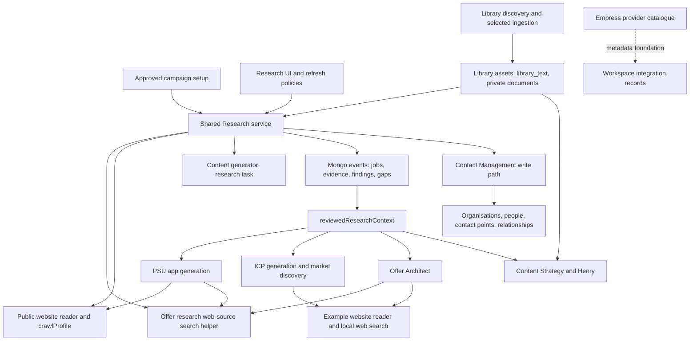
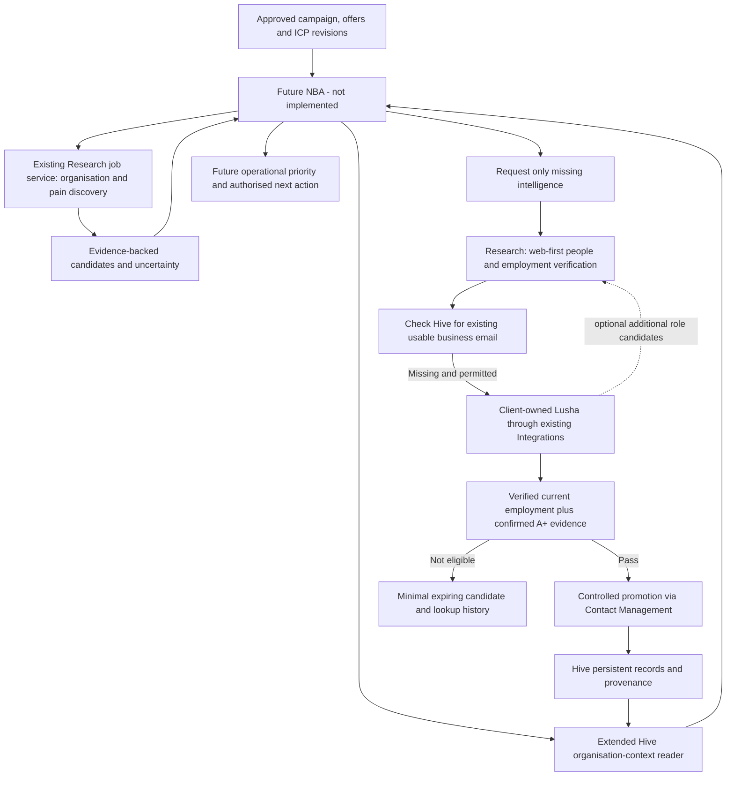

# HVM Research Architecture Audit — Existing Capabilities and NBA Readiness

14 October 2026 · Read-only architectural audit · For review, not implementation authority

## 1. Executive Summary

**Extend the existing Research service; do not replace it or migrate all function-specific research into it.** It already owns typed requests, asynchronous jobs, safe public crawling, web-source discovery, evidence persistence, review, scheduled/triggered refresh and campaign research. It is a substantial foundation, but it is **not yet the proposed web-first person verification and client-funded Lusha enrichment pipeline**.

**Hive contains much of the data NBA will need, but does not yet expose the complete organisation dossier described in the request.** People, organisations, contact points, employment relationships, product/customer relationships and communication events exist. Contact-context retrieval and restrictions also exist. The missing increment is an authorised organisation-centred aggregation, including related contacts' history, campaign involvement, qualification and current management state. A new CRM is unnecessary.

Principal findings:

- Campaigns already initiate the shared Research service. They supply approved version-bound products, offers and ICPs; research returns per-offer assessments. This is implemented functionality, not a future-only design.
- PSU, ICP and Offer Architecture retain their own generation/research paths. They also consume reviewed shared findings. Keep this arrangement.
- ICP already separates account characteristics, research/pain criteria, adoption readiness and targeting coverage. Preserve it; formalise only the machine-readable criteria needed by discovery, without restoring manual rule authoring.
- **Current Research can create Hive organisations and contacts during discovery.** A contact email appearing with a person's name in cited text can suffice. There is no Lusha A+ gate, no explicit current-employment verification stage and no separate expiring candidate store. This is the largest behavioural mismatch with the proposed flow.
- **Lusha is not connected by the inspected implementation.** It appears in a client-provider list; Empress has provider definitions and client integration records have secret-reference fields. The app route creates pending metadata, not a working authenticated connection. No Lusha adapter, account test, A+ mapping or actual credit ledger was found.
- Existing duplicate prevention is useful but narrower than the target: request keys, job leases, domain/email matching and overlapping research of explicitly selected entities. It is not a cross-campaign contact-management reservation or paid-enrichment lookup ledger.
- No NBA decision engine was identified. Existing `nbaStatus`, eligibility, Contact Strategy assessments and campaign measurement are foundations, not an implemented NBA.

### Scope and evidence standard

Inspected current working-tree source in `vamberic-platform-api`, `hvm-app` and relevant `vamberic-agent-runtime` adapters, schemas, routes, tests and documentation. Source includes uncommitted work and the model migration in progress. This is **code evidence**, not a certification of deployed configuration, Mongo contents, credentials, provider access or production correctness. No application tests, provider requests, AWS/Mongo inspection or live writes were performed for this audit. Prior smoke tests are not treated as proof of this architecture. The only file created is this report; no implementation tasks were created.

In this report, “implemented” means a concrete code path exists; all live behaviour remains unverified by this audit. “Partial” means some required behaviour exists. “Missing” means no implementation was found in the inspected relevant source, not a claim about every external system.

## 2. Current Research Architecture

The shared service reuses lower-level helpers from PSU and Offer Architecture. That is already useful reuse; it is not evidence that those functions must call the shared job service themselves. The Research worker runs inside the API process when enabled, not as a newly required autonomous Agent. Library discovery remains separate from ingestion.

### Source reference key

All API links below resolve relative to this report's existing documentation folder. Function names are supplied to make evidence independently inspectable.

| Key | Source and principal entry points |
|---|---|
| R1 | [Research contracts](../artifacts/api-server/src/services/research/model.ts): `researchRequest`, `researchOutput`, `researchTypes`, `policyInput`, `RESEARCH_INSTRUCTIONS` |
| R2 | [Research service](../artifacts/api-server/src/services/research/service.ts): `createResearchService`, nested `start`, `run`, `targets`, `librarySources`, `review`, `mutate`, `tick`, `evidenceFor` |
| R3 | [Research worker](../artifacts/api-server/src/services/research/worker.ts): `researchWorker`; [API composition](../artifacts/api-server/src/index.ts); [routes](../artifacts/api-server/src/routes/research.ts) |
| R4 | [Reviewed evidence](../artifacts/api-server/src/services/research/evidence-context.ts): `reviewedResearchContext`; [document context](../artifacts/api-server/src/services/research/context.ts): `readResearchContext` |
| P1 | [PSU generation](../artifacts/api-server/src/services/psu/generate.ts); [application](../artifacts/api-server/src/services/psu/application.ts): `createPsuApplication`; [quick summary](../artifacts/api-server/src/services/psu/quick-summary.ts): `validateQuickSummary`; [detailed profile](../artifacts/api-server/src/services/psu/detailed-profile.ts) |
| P2 | [Crawler](../artifacts/api-server/src/services/psu/research-crawl.ts): `crawlProfile`; [page reader](../artifacts/api-server/src/services/psu/page-reader.ts): `createWebsiteReader`, `requirePublicAddress`; [HTTP transport](../artifacts/api-server/src/services/psu/page-http.ts): `publicPageHttp` |
| I1 | [ICP generator](../artifacts/api-server/src/services/icp/generate.ts): `createIcpGenerator`, `icpContext`; [application](../artifacts/api-server/src/services/icp/application.ts); [definitions](../artifacts/api-server/src/domain/hive-definitions.ts): `ICP_LIST_FIELDS`, `ACCOUNT_LIST_FIELDS`, `BUYER_LIST_FIELDS` |
| I2 | [Market discovery](../artifacts/api-server/src/services/icp/discovery.ts): `createMarketDiscovery`; [eligibility](../artifacts/api-server/src/services/icp/eligibility.ts): `discoveryStart`, `discoveryRead`; [ICP routes](../artifacts/api-server/src/routes/icp.ts) |
| O1 | [Offer search](../artifacts/api-server/src/services/offer-architecture/research.ts): `createOfferResearch`; [offer generation](../artifacts/api-server/src/services/offer-architecture/generate.ts): `createOfferGenerator`, `responseSchemaForMethodology`; [application](../artifacts/api-server/src/services/offer-architecture/application.ts) |
| C1 | [Content context](../artifacts/api-server/src/services/content-strategy/context.ts): `contentContext`; [application](../artifacts/api-server/src/services/content-strategy/application.ts): `createContentStrategy`, `contentAccess`, `currentRecords`; [generator](../artifacts/api-server/src/services/content-strategy/generate.ts): `contentGeneratorFromEnvironment` |
| L1 | [Library](../artifacts/api-server/src/services/content-strategy/library.ts): `createLibrary`, `start`, `step`, `importPage`; [discovery](../artifacts/api-server/src/services/content-strategy/library-discovery.ts): `startDiscovery`, `discoveryStep`, `ingestionRecommendation`; [safe transport](../artifacts/api-server/src/services/content-strategy/discovery.ts): `readRaw`, `robotsAllowed` |
| L2 | [Private documents](../artifacts/api-server/src/services/research/documents.ts): `createResearchDocuments`, `createResearchStore`; [Library text](../artifacts/api-server/src/services/content-strategy/library-text.ts): `fullAssetText`; [frontend extraction](../../hvm-app/src/data/content-import.ts): `extractContentFile`; [Library ingestion UI](../../hvm-app/src/components/library-ingestion.tsx) |
| H1 | [CRM schemas](../artifacts/api-server/src/domain/schemas.ts): `PersonSchema`, `ContactPointSchema`, `OrganisationRelationshipSchema`; [CRM records](../artifacts/api-server/src/domain/crm-records.ts): `CrmLeadSchema`, `ExternalReferenceSchema` |
| H2 | [Contact Management](../artifacts/api-server/src/services/contact-management.ts): `createContactManagement`, `engagementSummaryPipeline`, `recordPipeline`; [contact context](../artifacts/api-server/src/services/contact-context.ts): `readContactContext`, `contactActionRestriction`, `createContactContext` |
| H3 | [HubSpot import](../artifacts/api-server/src/services/hubspot-import.ts); [contact strategy decisions](../artifacts/api-server/src/services/contact-strategy/decision.ts): `recordContactStrategyAssessment`; [interpretation](../artifacts/api-server/src/services/contact-strategy/interpret.ts): `strategyInterpreterFromEnvironment` |
| K1 | [Campaign contracts](../artifacts/api-server/src/services/campaigns/model.ts): `campaignSetup`, `campaignReadiness`; [service](../artifacts/api-server/src/services/campaigns/service.ts): `createCampaignService`, `start`, `audience`, `savePolicy`; [measurement](../artifacts/api-server/src/services/campaigns/measurement.ts): `campaignMeasurement` |
| X1 | [Empress schema](../artifacts/api-server/src/domain/operating.ts): `IntegrationProviderData`; [catalogue service](../artifacts/api-server/src/services/operating.ts); [workspace integrations](../artifacts/api-server/src/domain/workspace-integrations.ts): `WorkspaceIntegrationSchema`, `validateWorkspaceIntegrations`; [HVM routes](../artifacts/api-server/src/routes/hvm.ts): `integration-create/update/disconnect` |
| X2 | [Agent readiness](../artifacts/api-server/src/services/agent-execution-readiness.ts); [runtime secret composition](../../vamberic-agent-runtime/src/worker/main.ts); [runtime PSU adapters](../../vamberic-agent-runtime/src/agents/product-service-understanding/adapters.ts): `productAdaptersForWork` |

## 3. Research Inventory

“Leave” preserves the current function; it does not declare it defect-free. Storage names are Mongo collections unless identified as event types.

| Function / purpose | Trigger and implementation | Provider, input and output | Storage and provenance | Reuse, status and recommendation |
|---|---|---|---|---|
| PSU company/product summary | User Generate Summary; P1/P2 | Public HTTP crawl, optional independent company-mention search via O1, OpenAI structured generation. URL plus approved context → concise fields, source references, unknowns | `events`: `psu_generation_requested/preview/progress/finished`, `psu_review_saved`, `psu_company_saved`; canonical `offerings` and definition revisions. Page URL/digest/excerpt/retrieval evidence | Approved records and accepted shared evidence used downstream. Implemented; **LEAVE** local generation |
| PSU detailed profile | Selected saved product, detailed-generation action; P1 | Product summary and website evidence → delivery, responsibilities, capabilities, boundaries, terminology and unknowns | Same generation/review history and approved definition snapshots | Implemented; **LEAVE**. Does not require migration to Research jobs |
| PSU competitor suggestions | Summary generation; quick-summary schema/instructions P1 | Source-named competitors plus explicitly unverified general-knowledge suggestions | Stored with proposal/review context | Implemented suggestions, not verified competitor research. **LEAVE**, preserve distinction |
| Public crawling | Called by PSU and Research; P2 | HTTP, robots/sitemaps/supporting links; up to 100 pages per crawl; progress and partial source results | Caller persists results, not an independent global crawl database | Implemented shared helper; **LEAVE** security and bounded work |
| ICP definition generation | User generation using selected approved offer; I1 | Approved product/offer, full targeting instructions, customer examples/URLs, reviewed document and research context → fit/buyer/research criteria | `ideal_customer_profiles`, `hive_definition_revisions`, `events` including `icp_generation`, `icp_generation_result` and saved setup | Implemented; **LEAVE** definitions. **EXTEND** read/translation contract only where machine consumers need it |
| ICP organisation exploration | Explicit discovery action/policy; I2 | OpenAI web search, public query → up to six source-linked organisation suggestions with observation/uncertainty | `events`: `icp_market_discovery`; source URL, search evidence and usage retained in discovery result | Local exploration, not a full campaign engine. **LEAVE**; reuse helper concepts if useful, no forced migration |
| Offer Architecture research | Research & Generate Offer; O1 | OpenAI web search finds up to six source URLs; website reader reads discovered/supplied sources; model uses approved context and selected methodology | Offer-design working artifacts, research/competitive evidence, offer revisions, generation events; approved output can be registered through Content Strategy/Library | Implemented; **LEAVE**. Both methodologies share acquisition path; stage/schema/context differ |
| Offer brief preparation / Henry decisions | Brief generation and conversation; O1/C1 | LLM synthesis of supplied approved/working context; not independent evidence acquisition merely because it discusses competitors | Versioned proposals/decisions and conversation records | Implemented; **LEAVE**, do not count generated assertions as new research |
| Shared Research | User request, campaign request, explicit refresh policy; R1–R3 | Existing records/documents/Library; optional web search plus crawler; research LLM → findings, gaps, organisation/contact candidates, offer-specific assessments | `events`: `research_job/evidence/source/finding/gap/discovery/completed/policy`; actual CRM writes via H2 | Implemented foundation; **EXTEND** specialised discovery/verification/enrichment behaviours |
| Contact Strategy | User policy interpretation/assessment; H3 | LLM interprets natural language; local restriction/context evaluation. No web discovery in inspected path | Strategy records and assessment events | Implemented policy support, not NBA. **LEAVE** |
| Contact Management/import | Upload/manual edits/history review; H1–H3 | Deterministic parsing, identity matching, imported communication context; no external enrichment | `organisations`, `people`, `contact_points`, `organisation_relationships`, external references and import/history events | Implemented data foundation; **EXTEND** organisation dossier and candidate promotion reuse |
| Content Strategy / Henry | User generation/conversation; C1 | Approved company/product/offer/ICP, Brand Kit, selected Library and reviewed research → strategy, gaps, actions/briefs; generator uses no web tools for these tasks | Versioned `content_strategy_record` and generation/proposal events; actions and brief handoffs | Implemented synthesis, not autonomous external investigation. **LEAVE**; expose existing Research request as a handoff if needed |
| Library website discovery | User starts/advances discovery; L1 | Sitemap/link metadata index, robots-aware; distinct inspection and ingestion state, index bound 5,000 | `library_discovery` resumable state, URLs, dates, locale, selection/import status | Implemented; **LEAVE** discovery/ingestion distinction |
| Library ingestion / asset analysis | Explicit selected page/external URL import or file upload; L1/L2/C1 | Safe page extraction or browser document extraction, then optional structured analysis; original file retained | `content_strategy_record` assets, `library_text`, `research_document` events and versioned private S3 originals; provenance/restrictions/revisions | Implemented; **LEAVE**. Research reads selected assets; not all stored formats are semantically analysed |
| Research documents | User selects reviewed extract, including PSU/ICP inputs; R4/L2 | Reviewed excerpts and grain/provenance; no claim full source analysed | `research_document` revisions, private versioned objects | Implemented; **LEAVE** cross-function reference reuse instead of duplicate upload |
| Legacy Agent runtime PSU / fake research | Registered runtime invocations and test fixtures; X2 | Existing model/adapter pipeline; fake research uses synthetic labels and example.invalid | Runtime execution/evidence history | Separate legacy infrastructure, not the shared app Research service. **LEAVE**; fake research is not a live discovery provider |

## 4. Shared Research Service Assessment

### Contracts and execution

R1 exposes nine request types: `company_product`, `market_buyer`, `account_discovery`, `contact_discovery`, `enrichment`, `personalisation`, `content_evidence`, `situational`, `knowledge_gap`. A request includes objective, brand and approved record revisions, destinations, URLs, selected document/asset references, source mode and freshness days. **This already lets callers express an objective without implementing web retrieval.**

However, distinct names currently largely share one search/crawl/generate path. `enrichment` is not a paid-provider resolver, and there is no typed `verify_current_employment` or `business_email_lookup` contract. Contacts are a flat name/title/email/company-website proposal; pain/readiness are largely rationale and findings, not separate claim-level verification results.

`start` persists an idempotent request and checks authority/context. `run` claims a ten-minute lease with token fencing; interrupted runs have a three-attempt bound. Routes can start background execution; `researchWorker` polls `tick` every 30 seconds when `HVM_RESEARCH_WORKER_ENABLED=true`. Progress is persisted in the job; terminal states distinguish completed, partial, failed and cancelled. Cancellation/retries and refresh policies exist. This is a Mongo-backed API worker, not a durable provider transaction system.

### Providers and costs

Web mode with no supplied URLs calls O1's `createOfferResearch` with purpose `research-discovery`. It uses OpenAI web search and returns at most six URLs; `crawlProfile` follows public content from those seeds. With supplied URLs, search is skipped. A ContentGenerator performs structured assessment. Existing mode works from supplied context/evidence. Provider selection is by server composition/environment and dependency injection, **not client Integrations discovery**.

Model/token/tool usage is retained in job payloads on successful stages. This is not actual Lusha credit accounting. A late failure can leave earlier external work incompletely accounted in the final job: search usage is collected locally before later `update({usage})`. Paid enrichment needs a durable attempt/charge ledger and recovery/reconciliation; a job lease alone cannot make an external paid request exactly-once.

### Evidence, confidence and reuse

R2 stores URL, title, digest, retrieved timestamp, excerpt length/truncation, access and context references. Public `publicationDate` is currently null. Findings distinguish fact/inference/recommendation and require human review; unsupported facts are downgraded. Source IDs are filtered against actual supplied evidence. This validates attribution, not truth, identity or employment recency.

Fresh public evidence is reused by brand and matching URL/objective; campaign URLs get an extra reuse lookup. Findings accepted by a human are available through R4 to PSU, ICP, Offer Architecture and Content Strategy. `evidenceFor` retrieves destination-linked findings. Research results are reusable **now**, without flattening all research into one pipeline.

Limitations: freshness is mainly retrieval age, not when the fact became true; no standard source-credibility or employment-confidence assessment; no provider-backed email grade; accepted-context reader limits to 20 findings and is not a complete intelligence dossier. Library text sent into Research is bounded; private records are not copied into public search input automatically. The user objective itself is sent to web discovery, so future NBA must construct a public-safe query rather than place private instructions/data in that objective.

### Authority and creation boundaries

`contentAccess`, current membership resolution, workspace/brand filters, approved revision checks and context hashes are present. Destination records have scope checks. Current scheduled execution retains an audit principal and rechecks current access. Future NBA needs a narrowly authorised service invocation; it must not assume a stored human principal is general automation authority.

**Current discovery saves records before finding review.** R2 checks company name/source/domain, deduplicates by domain, then calls `createContactManagement.write`. For contacts it requires name and email in cited extracts, deduplicates by normalised email and may link the company. It can fill missing organisation industry/description or contact title in enrichment. It does not verify current employment, request A+ or wait for NBA selection. This should be extended at the promotion boundary for the new acquisition flow, not silently reinterpreted as compliant.

The existing tests (`test/research-service.test.ts`) cover idempotency, tenant denial, partial findings, cancellation, concurrent runners, policy triggers and source-backed contact creation. They were inspected, not executed here; they do not establish Lusha or live provider behaviour.

## 5. Hive and Contact Management Assessment

| Requirement | Implemented evidence | Limitation for future NBA |
|---|---|---|
| Organisation identity | H2 normalises website/domain, checks name/domain duplicates; import has external identities | Domain is not a legal-entity identity: subsidiaries, shared domains and rebrands need ambiguity handling, not automatic merging |
| People and employers | H1 `people`, `organisation_relationships` with jobTitle, employmentRole, department, seniority, dates, current and confidence | Fields exist; research does not establish fresh employment confidence before linking |
| Contact channels | `contact_points` normalised email/phone, validity, deliverability, suppression, departure flag, validation timestamps and employer relationship reference | No explicit Lusha grade/endpoint/account/credit evidence contract; “valid” must not be treated as A+ |
| Provenance | Base source/evidence metadata, external references, import events, `research_discovery` and findings | Provenance is distributed. A reader must preserve lineage rather than return only latest strings |
| Communications | H2 reads email/call/meeting/note/HubSpot history events; H3 imports email history | A person's recent 50 interactions are not an exhaustive paginated organisation timeline |
| Customer/qualification | Lifecycle import/control history, CRM leads, product relationships, opportunities | Organisation dossier must combine them; lifecycle is not equivalent to an offer-specific qualification decision |
| Permissions and suppression | `readContactContext` + `contactActionRestriction`; DNC, marketing/one-to-one suppression, departure/response review, inherited organisation restrictions | These are restrictions, not permission grants. Future NBA must also apply channel authority and current Contact Strategy |
| Engagement | `engagementSummaryPipeline` derives latest actual communication outcomes, not edits/imports | Organisation summary groups direct `organisationId` events; it does not automatically aggregate every associated contact's history |
| Campaign involvement | Campaign setup, assessments and measurement event shapes exist | Contact context does not aggregate campaign memberships/management; observed activity is not an exclusive management reservation |

`readContactContext(db,w,id)` accepts a person or organisation, but relationships and contact-point queries use `personId: id`. For an organisation ID that does **not** enumerate its people. Direct organisation interactions are returned; related people's interactions are not automatically joined. Campaign `audience()` does count current relationships and open opportunities, and explicitly says management is “not otherwise established” when no opportunity exists. These are useful building blocks, not the requested “everything we know” endpoint.

**Minimum extension:** compose an organisation-context reader from existing collections/readers, with pagination, source/age, explicit missing/truncated flags, entity resolution ambiguity, related contact channels and restrictions, product relationships, qualification, opportunities, campaign assessments and current management commitments. Keep the response scoped and revision-stamped; do not return secrets or all raw imported fields by default. Contact email absence must preserve the person record and employment history.

## 6. Integrations Assessment

Empress `IntegrationProviderData` supports name, category, authentication kind, operational capabilities, customer-owned-account requirements, guidance, documentation URL and cost drivers. Existing operating-layer versioning should remain the provider catalogue.

`WorkspaceIntegrationSchema` contains workspace/provider/account identity, status, scopes, AWS Secrets Manager reference and connection/sync timestamps. It explicitly disallows arbitrary credential/raw-error metadata. `validateWorkspaceIntegrations` is a reference validator, **not** a credential accessor or authorisation grant.

The HVM client endpoints accept provider/name/account metadata, create `pending`, permit editing pending metadata and disconnect records. The provider list includes `lusha`, but these endpoints do not take a key, test an account or make a connection operational. The global provider catalogue and this static client provider list are not yet a complete capability-driven resolver.

Existing Agent readiness checks provider/integration bindings and channel permissions; runtime composition reads configured secrets for its own model path. Neither proves that app Research can retrieve the current client's Lusha credential. **Reuse the catalogue, workspace connection object and authority conventions; implement the missing narrow connector, not a second integration framework or Agent registration requirement.**

Required verification before connector implementation (not performed because external calls are forbidden here): actual entitled Lusha endpoints; whether an A+ email rating is exposed and its exact semantics; search-by-company/role availability; credit charging for success/no-match/retry; permitted retention, caching and employment-source use; rate limits and test-connection cost. The requested A+ rule must fail closed for new managed contacts if unavailable. Existing contacts must remain intact.

## 7. Future NBA Research Flow

This diagram is proposed architecture, not current execution.

1. **Organisation discovery:** extend R2's account discovery and campaign context to make pain evidence, contradiction, source age and relevance explicit. The current search request receives objective/type, not the full structured ICP. Build a public-safe search brief from approved criteria; keep private context in the assessment step. Do not mistake model relevance for operational priority.
2. **Hive check:** use the extended dossier before people lookup and paid calls. Match by domain/external identity with ambiguity handling. Evaluate existing relationship and history rather than treating campaign admission as first contact.
3. **Missing information:** add narrow objective-specific inputs/output states to R1. Distinguish known contact refresh, missing email, role vacancy/unknown employment, and new organisation selection. Reuse evidence before fetching again.
4. **People discovery:** current generic contact discovery is partial. Add role-targeted web discovery and current-employment evidence evaluation using permitted sources. No LinkedIn scraping/access bypass is implied. Name/email co-occurrence alone is insufficient.
5. **Enrichment:** use tenant connection and paid-operation controls, lookup deduplication and actual credit evidence. Additional Lusha people are candidates sent back through employment verification. Preserve unsuccessful candidates separately with expiry; do not turn every provider result into a managed contact.
6. **NBA return:** research returns findings, candidate identity/match, evidence, gaps, freshness and readiness for evaluation. NBA later determines operational priority, overlap handling and next action. No outreach or NBA implementation belongs in this increment.

## 8. Gap Analysis

P1 = required before the proposed operational acquisition/enrichment flow; P2 = useful subsequent strengthening; P3 = defer. Priorities describe dependencies, not newly created implementation tasks.

| Required capability | Existing implementation / status | Actual gap | Recommendation | Priority |
|---|---|---|---|---|
| Organisation discovery | R2 account discovery and I2 exploration implemented, live unverified | Query lacks structured ICP-derived discovery plan; creation is immediate | EXTEND R2; preserve I2 | P1 |
| Evidence of pain | ICP researchCriteria, findings and campaign rationale implemented partially | Explicit supporting/contradicting signals, per-claim age and unresolved evidence contract | EXTEND existing outputs | P1 |
| Organisation prioritisation | Per-offer fit/unknown assessment partial | Evidence relevance ordering vs operational priority not an executable separation | EXTEND research relevance; defer NBA prioritisation | P1 |
| Hive organisation matching | Normalised domain/name and external references implemented | Shared-domain/legal-entity ambiguity and dossier entry point | EXTEND matching/reader | P1 |
| Existing contact retrieval | Relationships, points, per-contact context implemented | No complete organisation-to-people context aggregation | EXTEND H2 | P1 |
| Communication history retrieval | Interaction events and imported emails implemented | Organisation roll-up, pagination and campaign context absent from unified reader | EXTEND H2 | P1 |
| Person discovery | Generic source-backed contact proposals partial | No role-first identity pipeline independent of finding an email | EXTEND R2 with specialised stage | P1 |
| Current employment verification | Relationship dates/confidence fields exist; verifier missing | Evidence-backed current employer/role decision, uncertainty and age | BUILD focused verifier inside Research | P1 |
| Contact deduplication | Email normalisation and ambiguity checks implemented | Job changes/missing email/person identity; avoid name-only automatic merges | EXTEND existing identity path | P1 |
| Lusha integration | Catalogue + pending metadata only | Tenant credential connection/test/retrieval, endpoint adapter and resolver | BUILD narrow connector using X1 | P1 |
| A+ email filtering | Missing | Confirm provider semantics, persist grade provenance, gate new promotion | BUILD promotion check, preserve existing contacts | P1 |
| Supplementary Lusha discovery | Missing | Verify endpoint entitlement; re-enter candidate/employment flow | EXTEND connector after primary enrichment | P2 |
| Research provenance | IDs, URLs, digests, retrieval dates, reviewed findings implemented | Publication/claim age, confidence rationale, provider lineage | EXTEND, no evidence-store replacement | P1 |
| Research usage accounting | LLM/tool usage partial | Durable actual external credits, reservation/reconciliation and duplicate lookup prevention | EXTEND for external integration costs | P1 |
| NBA research request interface | Typed R1 request and completion event implemented | Service authority, missing-data objectives, neutral candidate return and structured failure contracts | EXTEND; do not build NBA | P1 |
| Cross-campaign management | Assessments, overlap text, opportunity hint and measurement shapes partial | Authoritative current management/reservation and arbitration | Define interface now; BUILD with future NBA | P1 before outreach |
| Temporary candidates | Discovery result events exist, but automatic CRM writes | Separate expiring candidates and lookup results before promotion | EXTEND Research persistence/promotion | P1 |
| Broad historical reindexing / vector search | Not needed for initial bounded flow | No demonstrated requirement | DEFER | P3 |

## 9. Preserve / Extend / Build Recommendations

**LEAVE:** PSU summaries and detailed generation; local ICP creation/exploration; methodology-specific Offer Architect stages and shared local source retrieval; Content Strategy synthesis/brief workflows; Library discovery separate from ingestion; private original storage; approved snapshots/human review; existing contact suppression and history; Agent runtime. Do not migrate historical evidence or regenerate client content for architectural tidiness.

**EXTEND:** shared Research typed objectives, public-safe discovery query composition, structured pain/employment evidence, candidate/promotion boundary, selective freshness and existing-data reuse, tenant provider resolution through current Integrations, organisation-context retrieval and durable external-usage accounting. Extend current readers and stores rather than introducing a generic new capability platform.

**BUILD only missing behaviours:** employment verification; actual Lusha connector/account test and credit reconciliation; A+ acceptance mapping; expiring pre-Hive candidate/lookup lifecycle. Future management reservation/arbitration belongs to NBA work. The new candidate lifecycle is necessary because unsuccessful paid lookups and unverified people must not become managed contacts.

## 10. Minimal Implementation Plan

These are recommendations for review, not created tasks or permission to implement.

### Phase 1 — Preserve and prepare

- Keep local research implementations and shared evidence reuse intact.
- Extend the existing Research request/result contract with selected entity, required roles/missing fields, purpose, evidence freshness and candidate-only versus explicitly authorised promotion behaviour.
- Add the authorised organisation dossier using H1/H2 and campaign records; report coverage/truncation and current restrictions.
- Make campaign discovery use a safe query derived from approved ICP criteria. Preserve independent offer assessments and unknowns.
- Define candidate state/expiry and entity matching before any new contact creation. Retain request leases and add external-attempt idempotency where paid work requires it.

### Phase 2 — Lusha integration

- Verify the account's actual API capabilities and A+ semantics before committing to a field mapping.
- Extend Empress metadata only where missing; connect the client's account through existing Integrations, with secure tenant-scoped credential handling and a truthful connection test.
- Add the narrow enrichment adapter, external-provider limits, actual credit records and no-match/error handling. These are external integration controls, not arbitrary AI quotas.

### Phase 3 — Research capabilities

- Start with one known, selected organisation: reuse Hive, identify role candidates on public/permitted sources, verify employment, look up only missing email, apply A+ and promote through existing CRUD with provenance.
- Then extend existing campaign account discovery to source-backed commercial-pain assessments. Keep discovery relevance separate from NBA operational decisions.
- Add supplementary Lusha role search later, reusing exactly the same verification/promotion path.

### Phase 4 — NBA integration requirements

- Specify caller authority, campaign/offer/ICP version references, dossier revision, requested missing intelligence, idempotency identity, progress, evidence results and explicit failure/partial states.
- Specify how NBA will read current contact strategy/suppression and acquire management ownership before any outreach. A research completion event is not execution authorisation.
- Do not implement NBA, communications, campaign sending or automatic offer arbitration in this audit's follow-on Research slice.

For the first Odyssiant campaign, defer supplementary provider discovery, large-scale continuous refresh, vector indexing, generic multi-provider routing, new screens and wholesale schema normalisation. Existing Research, Campaigns, Contact Management and Integrations screens are the starting surfaces. Do not defer employment checks, tenant credentials, the new-contact A+ gate or duplicate paid-lookup protection once enrichment is enabled.

## 11. Decisions Required

Only these unresolved choices need resolution before the corresponding implementation:

1. **A+ availability and fallback:** this is a provider-contract verification gate. If the client's API cannot supply the specified A+ rating, should enrichment remain unavailable until a suitable entitlement exists? Recommended default: yes; never silently substitute deliverability or a made-up confidence score.
2. **Candidate retention:** choose a finite retention period and minimum identity/evidence fields for unaccepted people and paid lookup suppression, consistent with provider terms. This should be a platform policy, not another campaign setup burden.
3. **Organisation promotion boundary:** the stated future sequence puts Hive creation after NBA selection, whereas current Research creates organisations during discovery. Recommended: new campaign discovery returns candidates; an explicit selection promotes through existing Contact Management until NBA exists. Preserve deliberate manual record creation.
4. **Employment evidence threshold:** agree what qualifies as sufficiently current evidence and when to request review (for example conflicting employers or an undated directory). Do not equate source retrieval date with employment verification.

No decision is needed to rebuild Research, redesign ICP, move every function into one service, create a second integrations framework or implement NBA now. The existing foundation makes the next phase contained, but **connecting Lusha alone is insufficient**: candidate handling, employment verification and the organisation dossier are the essential missing pieces.
